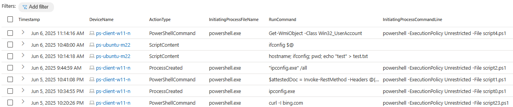

Hi there! I was recently asked whether it's possible to retrieve details about the actual commands executed via Azure VM Run Command when working with **Microsoft Defender** and **Sentinel**. Although there's no direct integration and Azure doesn't log these actions with such granularity by default in central manner, I decided to dig deeper into the topic.

> The most obvious option would be to use PowerShell Transcription logging on Windows together with **Azure Monitor** to ingest the logs. However, I wanted to investigate whether we could leverage Defender Endpoint telemetry instead to retrieve Run Command activity.
{: .prompt-info}
> Latest KQL query can be found in my [GitHub repo](https://github.com/pisinger/hunting/blob/main/defender-azure-vm-run-commands-hunting.kql).
{: .prompt-tip}

## Update: why Run Command deserves attention again

> Below section updated 06-Nov 2026
{: .prompt-warning}

Azure Run Command is back in focus after Microsoft documented its abuse by **Storm-2949** in a 2026 campaign. The group used Run Command to execute scripts on Azure VMs, including an attempt to request a managed-identity token from the Instance Metadata Service (IMDS) and use it to access Key Vault. In the reported case, that attempt failed because the VM's managed identity did not have the required Key Vault permissions. The actor also used Run Command to deploy remote access software and reduce host security visibility on some VMs. See [Microsoft's Storm-2949 investigation](https://www.microsoft.com/en-us/security/blog/2026/05/18/storm-2949-turned-compromised-identity-into-cloud-wide-breach/).

This is the gap this hunt is meant to help close: **Azure Activity Logs can tell you that Run Command was invoked; endpoint telemetry may reveal the script or follow-on activity.** The endpoint view depends on the operating system, Defender configuration, retention, and the execution path. Treat it as an investigation signal, not a complete audit record.

### A persistent attack vector as agentic attacks grow in importance

Run Command is a built-in Azure management capability, so its abuse is not unique to one threat actor. Any attacker who gains an identity with the required permissions can potentially use it to execute code on reachable VMs. Agentic tooling could make it easier to chain reconnaissance, permission discovery, and remote execution quickly across a cloud environment. Microsoft has separately reported agentic-driven cloud attacks by Storm-3168, illustrating that this broader shift is already being observed; that reporting does **not** attribute Run Command use to Storm-3168, nor does it say Storm-2949 used agents. The practical takeaway is to monitor the control-plane operation and investigate the resulting endpoint activity regardless of whether the operator is human, automated, or a combination of both. [Microsoft on Storm-3168](https://www.microsoft.com/en-us/security/blog/2026/09/25/storm-3168-agentic-driven-cloud-attacks-using-compromised-service-principals/).

MITRE ATT&CK tracks this broader behavior as [T1651, Cloud Administration Command](https://attack.mitre.org/techniques/T1651/), which explicitly includes Azure Run Command. Its guidance recommends limiting accounts that can run commands on VMs, using temporary privileged access where possible, and correlating cloud control-plane activity with host-level execution. That maps directly to the RBAC controls and Defender hunt in this post.

## Reduce exposure without losing visibility

- **Restrict the permission.** Running an action Run Command requires `Microsoft.Compute/virtualMachines/runCommand/action`. The built-in **Virtual Machine Contributor** role includes it, as do broader roles. Review role assignments at the VM and inherited scopes; use a narrowly scoped custom role where appropriate. For privileged roles, consider eligible, time-bound assignments through [Microsoft Entra Privileged Identity Management](https://learn.microsoft.com/en-us/azure/active-directory/privileged-identity-management/pim-resource-roles-assign-roles). See [Microsoft's Run Command access guidance](https://learn.microsoft.com/en-us/azure/virtual-machines/windows/run-command).
- **For Azure Arc servers, block only the Run Command extension where it is not needed.** The Azure Connected Machine agent supports a locally enforced extension allowlist or blocklist. For example, on a Windows Arc server:

  ```shell
  azcmagent config set extensions.blocklist "Microsoft.CPlat.Core/RunCommandHandlerWindows"
  ```

  Use `Microsoft.CPlat.Core/RunCommandHandlerLinux` for Linux. Microsoft recommends allowlists for sensitive Arc servers when practical. These local Arc controls do not apply to Azure VMs. See [Arc extension security](https://learn.microsoft.com/en-us/azure/azure-arc/servers/security-extensions).
- **Avoid disabling the Arc extension manager as a blanket control.** Extensions can provide monitoring and security capabilities; Microsoft notes that extension-manager-hosted agents such as Azure Monitor Agent do not run when the manager is disabled. Review the extensions and dependencies required in your environment before enforcing an allowlist.
- **Keep both sides of the investigation.** Alert on the Azure control-plane operation and correlate it with Defender endpoint events. A control-plane event establishes who invoked the action and when; endpoint telemetry can add what was written or executed, when available.

The sections below show where the scripts may be stored locally and how I correlate the related Defender telemetry. The query is useful for hunting, but it does not guarantee full script recovery on every VM.

### Example custom role permission patterns

The following are **starting points, not drop-in role definitions**. Review the required permissions for your environment and test the resulting role at the intended scope. In particular, `NotActions` subtracts permissions only from the wildcard in that role; it is **not a deny** and does not override permissions granted by another role assignment. See [how Azure custom role exclusions work](https://learn.microsoft.com/en-us/azure/role-based-access-control/custom-roles-portal#exclude-permissions).

This example shows the pattern for a VM management role based on the Compute VM wildcard, excluding Action Run Command, Managed Run Command, and Diagnostic Run Command operations. For the standard **Action Run Command** path discussed in this post, the key permission is `Microsoft.Compute/virtualMachines/runCommand/action`; the other exclusions cover distinct command features:

```json
{
  "Name": "VM Management (without Run Command)",
  "IsCustom": true,
  "Description": "Illustrative Compute VM permissions excluding Run Command operations",
  "Actions": [
    "Microsoft.Compute/virtualMachines/*"
  ],
  "NotActions": [
    "Microsoft.Compute/virtualMachines/runCommand/action",
    "Microsoft.Compute/virtualMachines/diagnosticRunCommand/action",
    "Microsoft.Compute/virtualMachines/runCommand/write",
    "Microsoft.Compute/virtualMachines/runCommands/*",
    "Microsoft.Compute/virtualMachines/diagnosticRunCommands/*"
  ],
  "AssignableScopes": [
    "/subscriptions/<subscriptionId>"
  ]
}
```

If you also want this role to prevent users from installing or updating VM extensions, add `Microsoft.Compute/virtualMachines/extensions/write` to `NotActions`. That blocks **all** VM extension create/update operations, not just script extensions, so assess effects on your extension management and security tooling first. VM Scale Set permissions need their own matching exclusions if the role grants VM Scale Set actions.

For a separate operator role, grant only the Run Command operations the operator needs. Microsoft documents `Microsoft.Compute/virtualMachines/runCommand/action` as the permission required to run the standard **Action Run Command**. This minimal example grants that action on Azure VMs:

```json
{
  "Name": "Azure VM Action Run Command Operator",
  "IsCustom": true,
  "Description": "Illustrative role for Action Run Command on Azure VMs",
  "Actions": [
    "Microsoft.Compute/virtualMachines/read",
    "Microsoft.Compute/virtualMachines/runCommand/action"
  ],
  "NotActions": [],
  "AssignableScopes": [
    "/subscriptions/<subscriptionId>"
  ]
}
```

Managed Run Command uses a separate write permission; its [feature-specific access guidance](https://learn.microsoft.com/en-us/azure/virtual-machines/windows/run-command-managed) names `Microsoft.Compute/virtualMachines/runCommand/write`. The Compute permission catalog lists the Managed Run Command child-resource operations under `Microsoft.Compute/virtualMachines/runCommands/*`. Diagnostic Run Command uses `Microsoft.Compute/virtualMachines/diagnosticRunCommand/action`. Add permissions only for features intentionally in scope, and verify the effective permissions in your environment. See the [Compute permission list](https://learn.microsoft.com/en-us/azure/role-based-access-control/permissions/compute).

Keep Azure Arc permissions in a separate role: Arc uses the `Microsoft.HybridCompute` resource provider and has its own local agent controls. Check the current [Compute permission list](https://learn.microsoft.com/en-us/azure/role-based-access-control/permissions/compute) and the [Arc Run Command access guidance](https://learn.microsoft.com/en-us/azure/azure-arc/servers/run-command) before deploying either role.

See below example result when running above query in Defender Advanced Hunting:


Run Command activity on Azure VM via Defender AH

## ▶️Azure VM Run Command

Azure VM Run Command provides a convenient way to execute scripts or commands on Azure Virtual Machines without requiring direct login access. It's especially handy for administrative tasks, troubleshooting, and automation scenarios. However, capturing the exact content of the commands executed through this feature - especially in a flexible or auditable way - can be somewhat challenging.

There are two Azure VM Run Command modalities, and they use different control-plane operations:

- **Action Run Command** is the original one-off operation, such as `az vm run-command invoke` or the portal's Run command experience. Running it requires `Microsoft.Compute/virtualMachines/runCommand/action`. It runs as **System on Windows** or **root on Linux**.
- **Managed Run Command** represents a command as a VM child resource (`Microsoft.Compute/virtualMachines/runCommands`). It supports longer-running work, multiple commands, sequencing, and a configurable execution user. Microsoft's feature-specific access guidance names `Microsoft.Compute/virtualMachines/runCommand/write` as the permission to run one; the Compute permission catalog lists the child-resource operations as `Microsoft.Compute/virtualMachines/runCommands/*`.

### Action Run Command examples

Run a shell script on a Linux VM with Azure CLI:

```shell
az vm run-command invoke \
  --resource-group "myRG" \
  --name "myVM" \
  --command-id RunShellScript \
  --scripts "echo Hello World!"
```

Run a PowerShell command on a Windows VM with Az PowerShell:

```powershell
Invoke-AzVMRunCommand -ResourceGroupName "myRG" -Name "myVM" -CommandId "RunPowerShellScript" -ScriptString "Write-Output 'Hello World!'"
```

### Managed Run Command examples

Create a Managed Run Command on a Linux VM with Azure CLI:

```shell
az vm run-command create \
  --name "myRunCommand" \
  --vm-name "myVM" \
  --resource-group "myRG" \
  --script "echo Hello World!"
```

Create a Managed Run Command on a Windows VM with the Az PowerShell cmdlet:

```powershell
Set-AzVMRunCommand -ResourceGroupName "myRG" -VMName "myVM" -Location "EastUS" -RunCommandName "RunCommandName" -SourceScript "Write-Output 'Hello World!'"
```

The KQL hunt uses extension files and endpoint process signals to find Run Command activity. I have verified that it works for both **Action Run Command** and **Managed Run Command** in my environment. Coverage still depends on the OS and available Defender telemetry, so treat it as a hunting aid rather than a complete audit record. Microsoft's [Run Command overview](https://learn.microsoft.com/en-us/azure/virtual-machines/run-command-overview) compares the two modalities.

General information about using Run Commands can be found in the [Azure documentation](https://learn.microsoft.com/en-us/azure/virtual-machines/run-command-overview).

## 📝Azure Activity Logs

Azure Activity Logs — specifically the AzureActivity table — can be queried to identify when Run Command actions were executed on Azure Virtual Machines. However, these logs only capture the occurrence of the action, not the actual content of the commands that were run. And that’s precisely the detail we’re after — especially for threat hunting scenarios or when enriching incidents with deeper context.

To check for **Action Run Command** executions in Azure Activity Logs, you can use the following query. It filters for the action operation and does not cover Managed Run Command resource writes:

```shell
AzureActivity
| where OperationNameValue =~ "MICROSOFT.COMPUTE/VIRTUALMACHINES/RUNCOMMAND/ACTION"
```

## 🛠️Off topic - repair Run Command extension

Before diving into how to retrieve Run Command data, I want to briefly touch on a related issue — repairing the Run Command extension on Azure VMs. This can be helpful if you run into problems with the extension itself.

> Why bring this up? Because I ran into this exact issue in my own lab. After experimenting with various configurations — removing downloaded scripts, resetting the extension, and more — I somehow broke the Run Command extension. Attempts to fix it manualy only made things worse. Eventually, I found a way to reinstall the extension using PowerShell, which I’ll share below.
{: .prompt-tip}

```shell
Invoke-AzVMRunCommand -ResourceGroupName "myResourceGroup" -Name "myMachine" -CommandId "RemoveRunCommandWindowsExtension"
```

To reinstall the extension, you can simply trigger a new Run Command execution — this will automatically re-provision the extension if it's missing. It’s worth noting that the Run Command extension isn’t pre-installed on Azure VMs and also doesn’t appear under the list of installed extensions in the Azure Portal. Instead, it’s provisioned on demand the first time a Run Command is executed.

## 🔍Where to find the Run Commands logs locally

Action Run Command executes within the VM agent context (System on Windows, root on Linux). Managed Run Command can use a configured execution user. These actions aren’t captured in full detail by Azure Activity Logs or Diagnostics Logs. The local script and handler paths differ by modality; examples observed on this VM are listed below. The KQL hunt has been tested with both modalities, though endpoint telemetry and script visibility can vary by OS.

These scripts are placed in a specific directory used by the Run Command extension, from where they are picked up and executed. This local presence can be useful for forensic analysis or troubleshooting, especially when deeper visibility into command content is required.

- **Windows**: `C:\Packages\Plugins\Microsoft.CPlat.Core.RunCommandWindows\<version>\Downloads`
- **Linux**: `/var/lib/waagent/run-command/download`
- **Linux Arc**: `/var/lib/waagent/run-command-handler/download`

On the Linux Azure VM used for this update, I also observed different handler executables for the two Azure VM modalities:

- **Action Run Command**: `/var/lib/waagent/microsoft.cplat.core.runcommandlinux-1.0.12/bin/run-command-extension`
- **Managed Run Command**: `/var/lib/waagent/microsoft.cplat.core.runcommandhandlerlinux-1.3.28/bin/run-command-handler`

The version numbers above are what this VM had at the time of testing; extension versions and paths can change. These are handler executable paths, while the download directories listed above are where script files may be staged.

On Linux VMs, the Run Command logs — including stdout and stderr — can be found in the same directory where the script is downloaded and executed. These logs provide insight into the output and any errors generated during execution. On Windows VMs, however, there's a dedicated status folder located at `C:\Packages\Plugins\Microsoft.CPlat.Core.RunCommandWindows\<version>\Status`.

## 🎯Retrieve Run Commands activity via Defender Telemetry

Since I wanted to avoid manually ingesting logs from individual VMs, I turned to **Defender Endpoint** and started analyzing its signals using the **Advanced Hunting** tables. While Defender isn’t designed to capture every operational detail, I was curious whether it logs Run Command activity in any meaningful way. And good news — it does! 💡🥳

> Spoiler alert: Based on my investigation, tracking the Run Commands through Defender AH works pretty well on Linux machines, including capturing the full script content. On Windows, the visibility is little more limited — it typically logs only certain executions, depending on the security context and Defender’s telemetry focus instead of the full script content.
{: .prompt-info}
> Keep in mind: Defender for Endpoint is a security solution, not a full auditing or monitoring tool. That said, it can still offer valuable insights into Run Command usage on Windows even while not seeing the full script content.
{: .prompt-warning}

To identify **Action and Managed Run Command** executions via Defender, you can use the following KQL query. It searches for relevant extension and endpoint events across Windows and Linux environments. I have tested it with both modalities. While Windows coverage may be partial, Linux systems often provide full script visibility — at least in the scenarios I tested 🙃. Diagnostic Run Command is a separate feature and is not covered by this validation.

> Latest KQL query can be found in my [GitHub repo](https://github.com/pisinger/hunting/blob/main/defender-azure-vm-run-commands-hunting.kql).
{: .prompt-tip}

```kql
let RunCommandsWindows = union DeviceFileEvents, DeviceProcessEvents
    | where InitiatingProcessFileName == "runcommandextension.exe" and (FileName contains ".ps1" and isnotempty(FileSize) or ProcessCommandLine contains '"cmd" /Cpowershell' )
    | extend FileName = iff(isnotempty(ProcessCommandLine), split(ProcessCommandLine, " ")[-1], FileName)
    | project Timestamp, DeviceId, DeviceName, FileName, SHA256, FolderPath, InitiatingProcessAccountName, FileSize
;
let RunCommandsWindowsFileName = RunCommandsWindows | summarize make_set(FileName);
//-----------------
let RunCommandsLinux = DeviceFileEvents
    | where (FolderPath contains "run-command/download" or FolderPath contains "run-command-handler/download") and FileName contains ".sh"
    | where ActionType == "FileCreated"
    | project Timestamp, DeviceId, DeviceName, FileName, FolderPath, SHA1, SHA256, InitiatingProcessAccountName, FileSize
    //| join kind=inner (DeviceEvents) on SHA256
    //| project Timestamp, FileName, SHA256, parse_json(AdditionalFields).ScriptContent
;
//let RunCommandsLinuxFileName = RunCommandsLinux | summarize make_set(FileName);
let RunCommandsLinuxFileSHA256 = RunCommandsLinux | summarize make_set(SHA256);
let DevicesFilter = union RunCommandsWindows, RunCommandsLinux | summarize make_set(DeviceId);    // to apply as filter
//-----------------
// using script FileName or its SHA256 on Linux for correlation
union DeviceProcessEvents, DeviceEvents, DeviceFileEvents
| where DeviceId has_any (DevicesFilter)
| where  ProcessCommandLine has_any (RunCommandsWindowsFileName) or InitiatingProcessCommandLine has_any (RunCommandsWindowsFileName) or SHA256 has_any(RunCommandsLinuxFileSHA256) 
| extend ScriptContent = parse_json(AdditionalFields).ScriptContent
| extend RunCommand = parse_json(AdditionalFields).Command
| extend RunCommand = iff (RunCommand == "" and not(ProcessCommandLine has_any (RunCommandsWindows) or ProcessCommandLine has_any(RunCommandsLinux)), ProcessCommandLine, RunCommand)
| extend RunCommand = coalesce (todynamic(RunCommand), ScriptContent)
| project Timestamp, DeviceId, DeviceName = split(DeviceName,".")[0], ActionType, FileName, FolderPath, InitiatingProcessFolderPath, InitiatingProcessFileName, RunCommand, ScriptContent, ProcessCommandLine, InitiatingProcessCommandLine, AccountName, AccountSid, LogonId, SHA256, ReportId
//-----------------
| project-away ScriptContent, ProcessCommandLine, LogonId, AccountSid, FileName, FolderPath
| where isnotempty(RunCommand) and InitiatingProcessCommandLine !has ("Cpowershell") and RunCommand !has ("Cpowershell") and InitiatingProcessFileName !in ("csrss.exe", "cmd.exe")
// exclude non runCommand related processes where any script.sh is run
| where not(ActionType == "ProcessCreated" and InitiatingProcessCommandLine has "script.sh" and InitiatingProcessCommandLine !has ("run-command") and RunCommand has "script.sh")
| sort by Timestamp desc
```

## 🔚Conclusion

While Azure VM Run Command is a powerful tool for remote management and automation, its visibility in standard logging solutions like Azure Activity Logs is limited — especially when it comes to capturing the actual command content. However, by exploring local VM paths and leveraging Defender Endpoint signals, particularly on Linux systems, we can uncover valuable insights that support threat hunting and incident enrichment. With the right combination of tools and queries, it's possible to bridge the visibility gap and enhance your security investigations.
