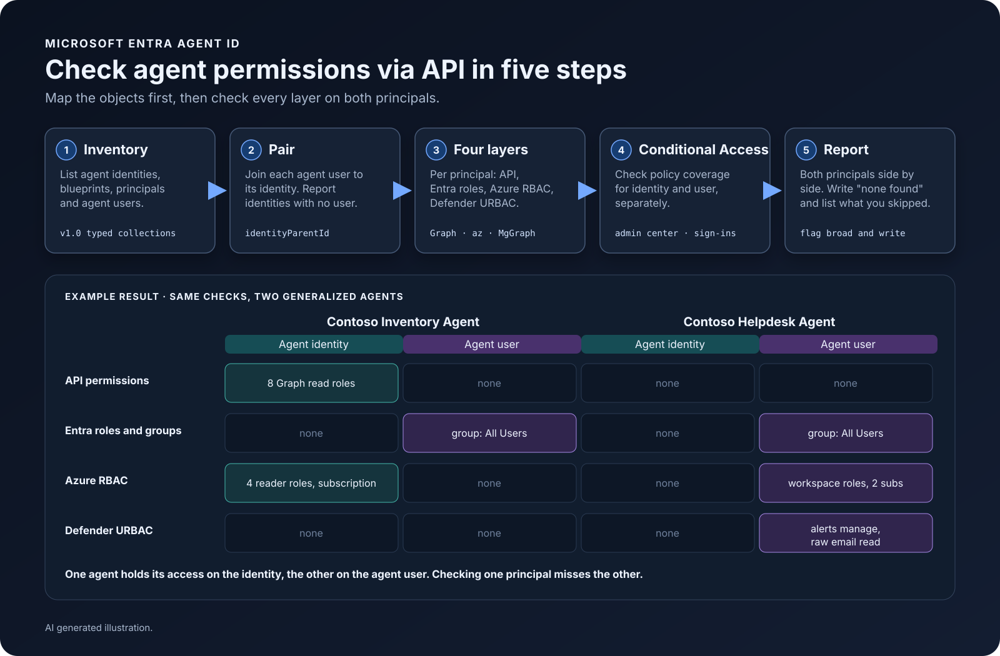
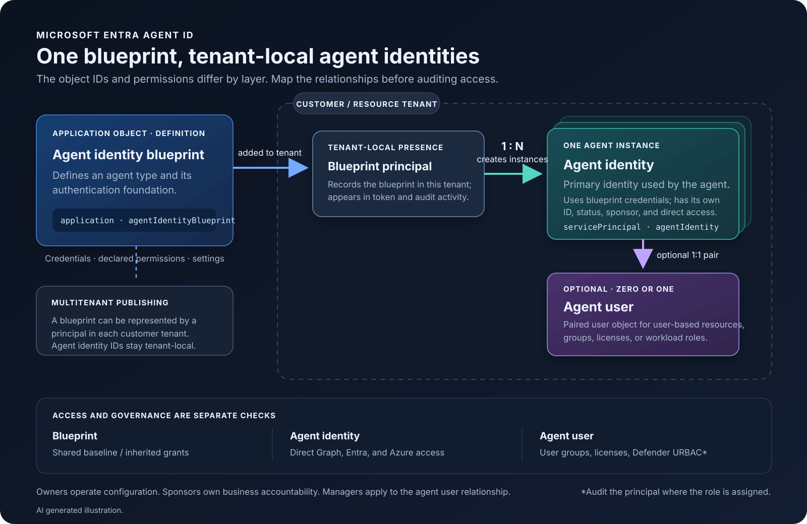
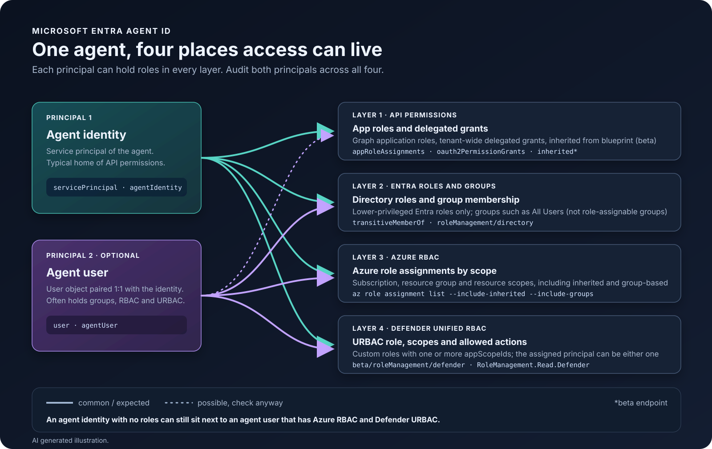
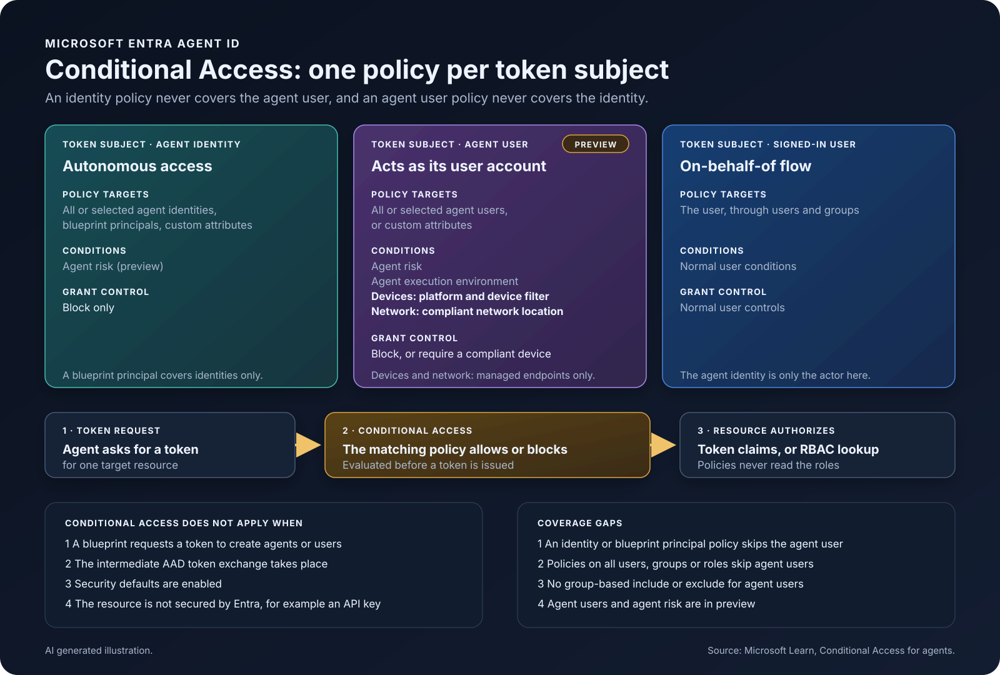

Giving an AI agent an application registration or a shared user account can get it running quickly. It also makes it harder to answer a basic question later: which agent acted, what identity did it use, and where did its access come from? Microsoft Entra Agent ID adds identity objects for that job. The underlying pattern will be familiar to Entra administrators: a blueprint is an application object, and its blueprint principal is the tenant-local service principal, much like an app registration and its service principal. Agent ID extends that model so one blueprint can create multiple agent identities in a tenant, with an optional agent user for each when the workload needs a user-shaped account.

I find the most useful way to understand it is to keep those objects separate. They have different jobs, different IDs, and can hold different access.

> An agent's access can sit on its **agent identity**, on its paired **agent user**, or on both, across four layers: API permissions, Entra roles and groups, Azure RBAC, and Defender URBAC. Check both principals in every layer. In my test tenant one agent held everything on its identity and another held everything on its agent user, so checking only the service principal would have missed it. Conditional Access can block an agent's access to target resources such as Microsoft Graph or Azure Resource Manager, and it has gaps for agent users and blueprints.
{: .prompt-tip}





## 🧩 The four objects and their relationships

| Object | What it represents | When it matters |
| --- | --- | --- |
| Agent identity blueprint | The application object that defines a kind of agent: authentication properties, credentials, declared permissions, and settings. | Build and govern a repeatable agent type. One blueprint can produce many agent identities. |
| Agent identity blueprint principal | The tenant-local representation of a blueprint added to a tenant. It records the blueprint’s presence and participates in token and audit activity. | The blueprint is used in a tenant, especially when the blueprint is multitenant. |
| Agent identity | The primary identity used by one running agent instance. It has its own object ID, status, sponsor, and direct access assignments. | Give an autonomous agent a distinct identity, or identify the agent actor in an interactive flow. |
| Agent user | An optional user object paired one-to-one with an agent identity. It can be assigned groups, licenses, and user-oriented resources. | The agent needs a resource or authorization model that requires a user object, such as a mailbox or certain workload roles. |

The blueprint is an application object. Agent identities are service-principal-derived objects with the `microsoft.graph.agentIdentity` type. The agent identity does not carry its own credentials; it uses credentials from the blueprint. The agent user is a separate object with its own ID and is not a replacement for the agent identity.

> **Analogy:** one way to remember the relationship is a **franchise and its locations**. The blueprint is the franchise playbook: it defines how that kind of agent is built and authenticated. A blueprint principal is the local franchise record in a tenant. Each agent identity is one running location, with its own local identity and access. An optional agent user is the staff badge for that location when it needs to use resources designed for users. The badge does not replace the location's operating identity.
{: .prompt-tip}

For a multitenant publisher, the blueprint can be present in multiple customer tenants through a blueprint principal. Each tenant then has its own agent identity objects. That tenant boundary matters when inventorying: a blueprint ID can be shared, while the agent identity IDs and their assignments are local to each tenant.

## 🎯 When to use each identity pattern

For an autonomous worker that runs on a schedule or responds to events, start with an agent identity. It gives the workload its own identity and makes its access reviewable without pretending the agent is a person.

For an interactive agent, the user remains the subject when the agent acts on that user’s behalf through delegated access and an on-behalf-of flow. The agent identity still identifies the agent as the actor. This distinction gives investigators a way to see both who initiated the work and which agent performed it.

Add an agent user only when the agent must interact with something that expects a user object. Examples include a mailbox, calendar, Teams resource, or a product-specific role model built around users. That user has separate group membership and permissions, so it expands the access review. Microsoft’s current agent-user documentation describes restrictions on credentials and administrative roles, and notes that creating the user directly through Graph does not provision Microsoft 365 capabilities such as a mailbox.

> **Default:** I would not create agent users by default. The agent identity is the primary identity; the paired user is an additional access surface with a concrete workload reason to exist.
{: .prompt-info}

## 👥 Owners, sponsors, and managers

Owners are the technical operators. They can change configuration and credentials within the scope of the object they own. Sponsors provide business accountability and make lifecycle decisions; a sponsor is required for an agent identity and a blueprint. Managers apply to agent users and represent the user-account relationship in the organization. These relationships are metadata and scoped capabilities, not substitutes for directory roles or resource permissions.

> **Sponsor vs owner:** that separation is useful in practice: the engineer who rotates a credential does not have to be the person who decides whether the business still needs the agent. Assign a sponsor who can explain the agent’s purpose and an owner who can operate it, then review both when the agent changes teams.
{: .prompt-info}

## 🔍 Inventory the objects with Microsoft Graph

The Entra admin center is a good place to search interactively: **Entra ID > Agents > Agent identities**. For repeatable reports, Microsoft Graph exposes the object collections. In the examples below, `az rest` uses your signed-in Azure CLI identity; grant only the required Graph permissions and directory roles in your environment.

The inventory examples use Graph `v1.0`, including the agent-user list. Microsoft Graph supports these typed collection paths directly, so you can keep the object types separate without retrieving every service principal or user and filtering locally.

```bash
# Agent identities created since a chosen UTC date
az rest --method get \
  --headers "ConsistencyLevel=eventual" \
  --url "https://graph.microsoft.com/v1.0/servicePrincipals/microsoft.graph.agentIdentity?\$filter=createdDateTime ge 2026-11-01T00:00:00Z&\$count=true&\$select=id,displayName,createdDateTime,accountEnabled,agentIdentityBlueprintId" \
  --query 'reverse(sort_by(value, &createdDateTime))[].{name:displayName,id:id,created:createdDateTime,enabled:accountEnabled,blueprint:agentIdentityBlueprintId}' \
  -o table

# Blueprint application objects
az rest --method get \
  --url "https://graph.microsoft.com/v1.0/applications/microsoft.graph.agentIdentityBlueprint?\$select=id,appId,displayName,createdDateTime,signInAudience" \
  --query 'reverse(sort_by(value, &createdDateTime))[].{name:displayName,objectId:id,appId:appId,created:createdDateTime,audience:signInAudience}' \
  -o table

# Blueprint principals installed in this tenant
az rest --method get \
  --url "https://graph.microsoft.com/v1.0/servicePrincipals/microsoft.graph.agentIdentityBlueprintPrincipal?\$select=id,appId,displayName,createdDateTime" \
  --query 'reverse(sort_by(value, &createdDateTime))[].{name:displayName,objectId:id,blueprintAppId:appId,created:createdDateTime}' \
  -o table

# All agent users and their parent agent identity IDs (no date filter, so pairing stays complete)
az rest --method get \
  --url "https://graph.microsoft.com/v1.0/users/microsoft.graph.agentUser?\$select=id,displayName,identityParentId,accountEnabled,assignedLicenses" \
  --query 'value[].{name:displayName,id:id,parent:identityParentId,enabled:accountEnabled,licenses:assignedLicenses}' \
  -o json
```

Example output, with names and IDs generalized. The agent identity list (the ID column is omitted for width):

```text
Name                      Created               Enabled    Blueprint
------------------------  --------------------  ---------  ------------------------------------
Sales Assistant Agent     2026-11-07T12:48:51Z  True       11111111-aaaa-4aaa-8aaa-000000000001
Document Summary Agent    2026-11-04T09:36:27Z  True       11111111-aaaa-4aaa-8aaa-000000000002
Ticket Routing Agent      2026-11-04T09:28:02Z  True       11111111-aaaa-4aaa-8aaa-000000000003
Contoso Helpdesk Agent    2026-11-04T09:26:06Z  True       11111111-aaaa-4aaa-8aaa-000000000004
```

The blueprint list. For a blueprint, `ObjectId` and `AppId` are the same value:

```text
Name                                    ObjectId                              AppId                                 Created               Audience
--------------------------------------  ------------------------------------  ------------------------------------  --------------------  ------------
contoso-project-travel-agent-Blueprint  22222222-bbbb-4bbb-8bbb-000000000001  22222222-bbbb-4bbb-8bbb-000000000001  2026-09-21T07:40:24Z  AzureADMyOrg
contoso-project-hr-agent-Blueprint      22222222-bbbb-4bbb-8bbb-000000000002  22222222-bbbb-4bbb-8bbb-000000000002  2026-09-18T10:12:03Z  AzureADMyOrg
```

The blueprint principal list. Here `ObjectId` differs from the blueprint's app ID, so join on `appId`:

```text
Name                                    ObjectId                              BlueprintAppId                        Created
--------------------------------------  ------------------------------------  ------------------------------------  --------------------
contoso-project-travel-agent-Blueprint  33333333-cccc-4ccc-8ccc-000000000001  22222222-bbbb-4bbb-8bbb-000000000001  2026-09-21T07:40:31Z
```

The agent user list. `parent` is the object ID of the agent identity:

```json
[
  {
    "enabled": true,
    "id": "44444444-dddd-4ddd-8ddd-000000000001",
    "licenses": [],
    "name": "Contoso Helpdesk Agent",
    "parent": "55555555-eeee-4eee-8eee-000000000001"
  }
]
```

In a busy test tenant the blueprint and blueprint principal lists returned around a hundred rows each, mostly leftovers from test deployments. Paging and a naming convention matter once you have more than a handful of agents.

The relationship key is `identityParentId` on the agent user. Join that value to the agent identity’s object ID. The direct filter below worked in my test tenant, but confirm it in yours or retrieve the agent users and match the IDs client-side.

```bash
# List agent users for a specific parent agent identity
az rest --method get \
  --url "https://graph.microsoft.com/v1.0/users/microsoft.graph.agentUser?\$filter=identityParentId eq '$agentId'&\$select=id,displayName,identityParentId,accountEnabled" \
  --query 'value[].{name:displayName,userId:id,parent:identityParentId,enabled:accountEnabled}' -o json
```

A query for all agent users does not tell you which identities have no user, so build a map and report the missing pair explicitly. Follow `@odata.nextLink` for additional pages; a successful first response is not necessarily a complete tenant inventory.

Use the least-privileged Graph scopes for the inventory calls:

- `AgentIdentity.Read.All`
- `AgentIdentityBlueprint.Read.All`
- `AgentIdentityBlueprintPrincipal.Read.All`

The documented least privilege for listing agent users is `User.ReadBasic.All`, but this example selects `identityParentId`, `accountEnabled`, and `assignedLicenses`; use `User.Read.All` when those additional properties are required. A delegated query can also require a supported Entra role for the signed-in operator. Access-audit calls need additional read permissions, such as `Application.Read.All` for app-role assignments, `Directory.Read.All` for delegated grants and group membership, and `RoleManagement.Read.Directory` for directory role assignments. The exact permission set depends on which checks you run.

> **Inventory caveat:** treat these as inventory queries, not proof that the returned rows describe every effective permission. An empty or partial response can also result from missing permissions, an unsupported filter, paging, or replication delay. Keep request errors and pagination status with the report, and verify important findings in the resource that grants the access.
{: .prompt-warning}

## 🔐 Review access across both objects

The first pass should ask what access is assigned to the agent identity. App role assignments, delegated grants, group membership, and Entra directory roles are separate views. Also inspect inherited permissions from the blueprint: an identity's direct assignments do not show the complete effective permission picture.



An agent can hold access across four layers, but the checks differ by principal. App-role assignments, groups, Entra roles, and Azure RBAC may apply to either the agent identity or its agent user. Delegated permission grants are checked on the agent identity as the OAuth client; inherited blueprint permissions are a separate source.

> Microsoft's documentation limits what each principal can hold: agent identities can't receive certain highly privileged roles such as Global Administrator, Privileged Role Administrator or User Administrator. Agent users can't receive privileged administrator roles, but can join groups (not role-assignable groups), receive licenses and custom roles. Blueprints cannot hold Azure RBAC roles at all.
{: .prompt-info}

Those role restrictions are not a general least-privilege guarantee. Microsoft's current list of roles assignable to agent identities includes roles such as Exchange Administrator and Azure DevOps Administrator. Review the actual permissions and scope of every assigned role, rather than relying only on the roles the platform blocks. [Microsoft's allowed-role list](https://learn.microsoft.com/en-us/entra/agent-id/authorization-agent-id)

> **Privileged role restriction does not mean “no custom roles.”** Microsoft says agent users can't be assigned privileged administrator roles, and also explicitly allows custom role assignments. Review a custom role's permissions and scope on their own; the documentation doesn't define every custom role as nonprivileged. [Microsoft's agent-user documentation](https://learn.microsoft.com/en-us/entra/agent-id/agent-users)
{: .prompt-warning}

```bash
graphEndpoint='https://graph.microsoft.com/v1.0'
agentId='<agent identity object ID>'

# App roles assigned to the agent identity
az rest --method get --url "$graphEndpoint/servicePrincipals/$agentId/appRoleAssignments" \
  --query 'value[].{resource:resourceDisplayName,roleId:appRoleId}' -o json

# Delegated grants where this identity is the client
az rest --method get --url "$graphEndpoint/servicePrincipals/$agentId/oauth2PermissionGrants" \
  --query 'value[].{resource:resourceId,scope:scope,consentType:consentType}' -o json

# Groups and directory roles
az rest --method get --url "$graphEndpoint/servicePrincipals/$agentId/transitiveMemberOf" \
  --query 'value[].{type:"@odata.type",name:displayName}' -o json

az rest --method get \
  --url "$graphEndpoint/roleManagement/directory/roleAssignments?\$filter=principalId eq '$agentId'&\$expand=roleDefinition" \
  --query 'value[].{role:roleDefinition.displayName,scope:directoryScopeId}' -o json
```

Example output for an agent identity that has no direct access at all. Every query above returns an empty list, which is a valid and common result for a new agent:

```json
[]
```

For an agent identity that does have access, the app-role query returns role IDs only, which is hard to review:

```json
[
  { "resource": "Microsoft Graph", "roleId": "81b4724a-58aa-41c1-8a55-84ef97466587" },
  { "resource": "Microsoft Graph", "roleId": "483bed4a-2ad3-4361-a73b-c83ccdbdc53c" },
  { "resource": "Microsoft Graph", "roleId": "df021288-bdef-4463-88db-98f22de89214" }
]
```

An agent identity can also have delegated grants and no app roles. `resource` is the object ID of the resource service principal, not its name, and the `scope` string can start with a space:

```json
[
  { "consentType": "AllPrincipals", "resource": "<resource-sp-id-1>", "scope": " Operations.Execute.All" },
  { "consentType": "AllPrincipals", "resource": "<resource-sp-id-2>", "scope": " Runtime.All" }
]
```

To map each role ID to its display name, read the `appRoles` property of the target resource service principal and match the `appRoleId` from the assignments against the `appRoles` array.

```bash
tmp=$(mktemp -d)
az rest --method get \
  --url "$graphEndpoint/servicePrincipals/$agentId/appRoleAssignments" -o json > "$tmp/assign.json"

for rid in $(jq -r '.value[].resourceId' "$tmp/assign.json" | sort -u); do
  az rest --method get \
    --url "$graphEndpoint/servicePrincipals/$rid?\$select=appRoles" -o json > "$tmp/roles.json"
  jq --arg rid "$rid" --slurpfile r "$tmp/roles.json" '
    .value[] | select(.resourceId == $rid) |
    .appRoleId as $id |
    {
      resource: .resourceDisplayName,
      role: (first($r[0].appRoles[] | select(.id == $id) | .value) // "default access"),
      roleId: $id,
      created: .createdDateTime
    }' "$tmp/assign.json"
done | jq -s 'sort_by(.created) | reverse'

rm -rf "$tmp"
```

Example output of the resolution script, newest assignment first:

```json
[
  { "resource": "Microsoft Graph", "role": "Application.Read.All",              "roleId": "9a5d68dd-52b0-4cc2-bd40-abcf44ac3a30", "created": "2026-11-04T11:58:14Z" },
  { "resource": "Microsoft Graph", "role": "DelegatedPermissionGrant.Read.All", "roleId": "81b4724a-58aa-41c1-8a55-84ef97466587", "created": "2026-11-04T11:58:14Z" },
  { "resource": "Microsoft Graph", "role": "GroupMember.Read.All",              "roleId": "98830695-27a2-44f7-8c18-0c3ebc9698f6", "created": "2026-11-04T11:58:13Z" },
  { "resource": "Microsoft Graph", "role": "AuditLog.Read.All",                 "roleId": "b0afded3-3588-46d8-8b3d-9842eff778da", "created": "2026-11-04T11:58:13Z" },
  { "resource": "Microsoft Graph", "role": "RoleManagement.Read.Directory",     "roleId": "483bed4a-2ad3-4361-a73b-c83ccdbdc53c", "created": "2026-11-04T11:58:12Z" },
  { "resource": "Microsoft Graph", "role": "User.Read.All",                     "roleId": "df021288-bdef-4463-88db-98f22de89214", "created": "2026-11-04T11:58:11Z" }
]
```

The inherited-permission endpoints are currently Graph `beta`. They return effective grants inherited from the blueprint principal, and are read-only. The inherited delegated-grant endpoint returns only tenant-wide `AllPrincipals` grants; it does not include user-specific `Principal` grants. Both inherited endpoints return their full result in one response (no paging or OData query parameters), and to change what an agent identity inherits you edit the blueprint principal, not the agent identity.

```bash
# Inherited application permissions
az rest --method get \
  --url "https://graph.microsoft.com/beta/servicePrincipals/microsoft.graph.agentIdentity/$agentId/inheritedAppRoleAssignments" \
  --query 'value[].{resource:resourceDisplayName,roleId:appRoleId}' -o json

# Inherited tenant-wide delegated permissions
az rest --method get \
  --url "https://graph.microsoft.com/beta/servicePrincipals/microsoft.graph.agentIdentity/$agentId/inheritedOauth2PermissionGrants" \
  --query 'value[].{resource:resourceId,scope:scope,consentType:consentType}' -o json
```

Keep the ID-to-name mapping in your report, because role IDs alone are hard to review. Then repeat the user and role checks with the paired agent user ID. Azure RBAC and Defender Unified RBAC can be assigned to that user, so checking only the service principal can leave out real access. In my tests, the Defender URBAC assignment matched the agent user ID, not the agent identity ID.

```bash
# Resolve the optional user paired with this agent identity
az rest --method get \
  --url "https://graph.microsoft.com/v1.0/users/microsoft.graph.agentUser?\$filter=identityParentId eq '$agentId'&\$select=id,displayName,identityParentId" \
  --query 'value[].{name:displayName,userId:id,parent:identityParentId}' -o json

# For each returned userId, inspect its app roles, groups, and Entra role assignments
userId=<agent user object ID from the lookup above>
az rest --method get --url "$graphEndpoint/users/$userId/appRoleAssignments" \
  --query 'value[].{resource:resourceDisplayName,roleId:appRoleId}' -o json

az rest --method get --url "$graphEndpoint/users/$userId/transitiveMemberOf" \
  --query 'value[].{type:"@odata.type",name:displayName}' -o json

az rest --method get \
  --url "$graphEndpoint/roleManagement/directory/roleAssignments?\$filter=principalId eq '$userId'&\$expand=roleDefinition" \
  --query 'value[].{role:roleDefinition.displayName,scope:directoryScopeId}' -o json

# Azure RBAC for the agent identity, including parent-scope and group assignments
for sub in $(az account list --query "[?state=='Enabled'].id" -o tsv); do
  az role assignment list --subscription "$sub" --all --include-inherited \
    --include-groups --assignee "$agentId" \
    --query '[].{role:roleDefinitionName,scope:scope}' -o json
done

# Repeat for each paired agent user to include that user's group assignments
for sub in $(az account list --query "[?state=='Enabled'].id" -o tsv); do
  az role assignment list --subscription "$sub" --all --include-inherited \
    --include-groups --assignee "$userId" \
    --query '[].{role:roleDefinitionName,scope:scope}' -o json
done
```

Example output for the same agent, generalized. The agent user resolves from the identity:

```json
[
  {
    "name": "Contoso Helpdesk Agent",
    "parent": "55555555-eeee-4eee-8eee-000000000001",
    "userId": "44444444-dddd-4ddd-8ddd-000000000001"
  }
]
```

The agent identity itself had no app roles, groups, directory roles or Azure RBAC (`[]` for each). The paired agent user had a group membership and Azure RBAC on monitoring resources:

```json
[ { "name": "All Users", "type": "#microsoft.graph.group" } ]
```

```json
[
  { "role": "Reader", "scope": "/subscriptions/<sub-id>/resourceGroups/<rg>/providers/Microsoft.OperationalInsights/workspaces/<workspace>" },
  { "role": "Reader", "scope": "/subscriptions/<sub-id>/resourceGroups/<rg>/providers/Microsoft.OperationsManagement/solutions/SecurityInsights(<workspace>)" }
]
```

This is the reason to check both objects: looking only at the service principal would have reported this agent as having no access.

## 🧪 One script for both principals

The commands above are easier to run as a single script. It takes an agent identity object ID, finds the paired agent user, and prints all layers for both principals, with "none found" where a layer is empty. It needs the Azure CLI for Azure RBAC and Microsoft Graph PowerShell (`pwsh`), plus `jq` for the bash version, and it requests the delegated scopes listed in the script. It reuses an existing session and signs in only when needed: browser by default, device code in WSL or over SSH (override with `-Auth` or `AUDIT_AUTH`). I ran it against two agents in my test tenant (names generalized):

| Layer | Inventory Agent: identity | Inventory Agent: user | Helpdesk Agent: identity | Helpdesk Agent: user |
| --- | --- | --- | --- | --- |
| API permissions | 8 Graph read roles | none | none | none |
| Entra roles and groups | none | group `All Users` | none | group `All Users` |
| Azure RBAC | 4 reader roles at subscription scope | none | none | workspace roles in 2 subscriptions |
| Defender URBAC | none | none | none | alerts manage, raw email read |

The two agents are mirror images. Auditing only the agent identity would show the Inventory Agent as broadly privileged and the Helpdesk Agent as harmless, which gets the second one wrong.

> The full scripts are published in my [pisinger/scripts-lib](https://github.com/pisinger/scripts-lib/tree/main/agentic) repository (`agentic` folder), so they are not pasted here:
{: .prompt-tip}

```powershell
./audit-AgentAccess.ps1 -AgentId "<agent identity object ID>"
```

```bash
./audit-AgentAccess.sh "<agent identity object ID>"
```

Both print colored, grouped output with a flags summary at the end. This is an inventory of assignments visible to the current Graph and Azure CLI sessions, not a complete evaluator of every resource's effective access. Three details are easy to get wrong when you adapt the PowerShell version. Splatting a single argument such as `--include-groups` into `az` needs a forced string array (`[string[]]`), otherwise PowerShell unrolls it and passes it one character at a time. And call `Connect-MgGraph` in the same process as the queries, because a fresh `pwsh` process does not report an earlier session through `Get-MgContext`. Third, do not name your own sign-in helper `Connect-Graph`: it is a built-in alias of `Connect-MgGraph` once the module is loaded, and an alias wins over a function, so your helper is silently skipped. The scripts do not cover PIM-eligible roles, access packages, or Conditional Access, and the Azure RBAC part only sees subscriptions the signed-in account can see.

> **Disclaimer: the scripts are provided as is.** They only read data, but read the code before you run it in your tenant. They need broad read scopes, call Graph `beta` endpoints that can change, and print tenant data such as object IDs, role names and scopes, so handle the output as sensitive. The result is an inventory of what the signed-in sessions can see, not proof of effective access: PIM-eligible roles, access packages and Conditional Access are not covered. Test them in a non-production tenant first.
{: .prompt-warning}

The scripts check subscriptions visible to the signed-in Azure CLI account. `--all` includes assignments under each subscription, `--include-inherited` asks for parent-scope assignments such as management-group roles, and `--include-groups` expands assignments to groups for the paired agent user. Verify the returned scopes in your tenant, especially for management-group assignments. Also check for agent users with no matching parent identity, disabled accounts, and assigned licenses; those cases are easy to lose in a simple agent-to-user join.

> **Token note:** Defender URBAC is a special case: the `az` CLI token generally cannot request `RoleManagement.Read.Defender`. Use Microsoft Graph PowerShell with that delegated scope.
{: .prompt-tip}

This check can also help audit Defender workload permissions assigned to Microsoft Security Copilot agents or Project Perception agents when they use an agent identity. Match both the agent identity and its paired agent user ID, because the principal receiving the assignment can vary:

```powershell
$agentId     = '<agent identity object ID>'
$agentUserId = '<agent user object ID, or empty if none>'

# Reconnect only if the current session lacks the Defender scope (this replaces an existing Graph session)
if ('RoleManagement.Read.Defender' -notin (Get-MgContext).Scopes) {
  Connect-MgGraph -Scopes 'RoleManagement.Read.Defender' -NoWelcome
}

if ('RoleManagement.Read.Defender' -notin (Get-MgContext).Scopes) {
  throw 'The current Graph session does not have RoleManagement.Read.Defender.'
}

$graphEndpoint = 'https://graph.microsoft.com/beta/roleManagement/defender'
$assignments = @()
$next = "$graphEndpoint/roleAssignments"
while ($next) {
  $page = Invoke-MgGraphRequest -Uri $next
  $assignments += $page.value
  $next = $page.'@odata.nextLink'
}

$targetPrincipalIds = @($agentId, $agentUserId) | Where-Object { $_ }
$assignments |
  Where-Object {
    $targetPrincipalIds -contains $_.principalId -or
    (@($_.principalIds | Where-Object { $targetPrincipalIds -contains $_ })).Count -gt 0
  } |
  Select-Object roleDefinitionId, appScopeIds, principalIds
```

Example output, generalized. The tenant had 85 Defender URBAC role assignments in total, and one matched. It matched on the **agent user** ID, not on the agent identity ID, which is why the snippet checks both. The assignment is scoped to `/` (all data sources) and is shared with a second principal:

```json
{
  "roleDefinitionId": "66666666-ffff-4fff-8fff-000000000001",
  "appScopeIds": [ "/" ],
  "principalIds": [
    "77777777-aaaa-4aaa-8aaa-000000000001",
    "44444444-dddd-4ddd-8ddd-000000000001"
  ]
}
```

Resolving the role definition shows what the assignment allows:

```json
{
  "id": "66666666-ffff-4fff-8fff-000000000001",
  "name": "Agent Triage Role",
  "actions": [
    "microsoft.xdr/secops/securitydata/copilot/read",
    "microsoft.xdr/secops/securitydata/alerts/manage",
    "microsoft.xdr/secops/rawdata/emailwithalertcontent/read"
  ]
}
```

This is the access the earlier Entra and Azure RBAC queries did not show: the agent identity had nothing, yet its paired user can manage alerts and read raw email data with alert content across all scopes.

Assignments can also carry several scopes and a display name. The raw object below shows a typical shape: the role applies to the Defender XDR scope, a Sentinel scope and one specific workspace, and `directoryScopeIds` is separate from `appScopeIds`. Check every entry in `appScopeIds`, not only the first:

```text
appScopeIds        {/, /SentinelScope/team-a, /Workspaces/88888888-bbbb-4bbb-8bbb-000000000001}
roleDefinitionId   99999999-cccc-4ccc-8ccc-000000000001
directoryScopeIds  {/}
displayName        Team A - scope
principalIds       {77777777-aaaa-4aaa-8aaa-000000000002}
```

For a full report, page through `@odata.nextLink`, resolve each `roleDefinitionId`, and inspect `rolePermissions[].allowedResourceActions`. Report the role, its `appScopeIds`, and allowed actions for each principal. Also review the agent user's group membership; this snippet matches the two direct principal IDs. This query reports Defender XDR URBAC assignments.

For example, Microsoft documents assigning a Defender role to the Security Alert Triage Agent's agent identity. Security Copilot's own platform roles (Copilot owner and Copilot contributor) are not Microsoft Entra roles and are separate from URBAC. [Security Alert Triage Agent permissions](https://learn.microsoft.com/en-us/defender-xdr/security-alert-triage-agent); [Triage Agent setup and required permissions](https://learn.microsoft.com/security/agentic-security/triage-agent); [Security Copilot authentication and authorization](https://learn.microsoft.com/copilot/security/authentication).

> Blueprints deserve their own security and access review. A credential configured on a blueprint can be used through the agent token-exchange flow to obtain tokens for associated agent identities, including identities in consuming tenants. Datadog Security Labs demonstrated this in a scripted cross-tenant scenario in its [blueprint blast-radius analysis](https://securitylabs.datadoghq.com/articles/agent-id-blueprint-blast-radius/) and [cross-tenant compromise analysis](https://securitylabs.datadoghq.com/articles/agent-id-inside-agent-compromise/): after adding a secret to a publisher's blueprint, the researchers obtained a token for an existing agent identity in another tenant and exercised that identity's permissions. This is independent security research demonstrating the implications of the documented authentication model, not a Microsoft-confirmed vulnerability.
{: .prompt-warning}

Review who controls each blueprint, how its credentials are protected, and what permissions its agents can inherit or receive directly, especially for third-party and multitenant blueprints. The scripts in this post show secrets and certificates only when the blueprint application is in your tenant; for blueprints published elsewhere, they flag that credentials are not visible to you. Configured or declared permissions do not by themselves prove that access has been granted, so report inherited permissions and direct assignments separately.

## 🛡️ Conditional Access: what it covers and what it does not

Conditional Access runs when Entra issues or refreshes a token. It decides whether an agent gets a token for a **target resource**; it does not read the agent's roles. Agent policies can target Microsoft Graph and any resource that has an enterprise application in your tenant, and **All resources** covers everything Entra protects. For Azure management, Microsoft documents the *Windows Azure Service Management API* target as covering Azure Resource Manager. See Microsoft's [Conditional Access for agents](https://learn.microsoft.com/en-us/entra/identity/conditional-access/agent-id) and [agent targeting guidance](https://learn.microsoft.com/en-us/entra/identity/conditional-access/howto-target-agent-identities).



**Where the token fits.** Conditional Access is the gate before the token is issued. If it allows the request, Entra issues a token whose claims reflect the agent's access at that moment: `roles` for application permissions, `scp` for delegated scopes, and group membership. The resource then validates the token and makes its own authorization decision from those claims. Azure RBAC works differently: the Azure Resource Manager token carries identity and group membership, and Azure Resource Manager looks up the role assignments itself when each request arrives. Two practical effects follow. A change that is expressed as a claim (an app role, a group) reaches the resource only when the agent gets a new token, and an access token lives 60 to 90 minutes by default. An Azure role assignment change can take up to 10 minutes to apply.

**One policy per token subject.** Every access token has one subject, and a policy targets one subject. The policy builder offers the agent targets as separate choices (all agent identities or all agent users), not both at once, so an agent that uses its identity and its agent user needs two policies.

| Token subject | What the policy targets | Conditions | Grant control |
| --- | --- | --- | --- |
| Agent identity (autonomous) | All or selected agent identities, a blueprint principal, or custom security attributes | Agent risk (preview) | Block only |
| Agent user (preview) | All or selected agent users, or custom security attributes | Agent risk (preview), execution environment, device platform, device filter, network | Block, or require a compliant device (the agent user walkthrough also lists compliant network as a grant) |
| Signed-in user (on-behalf-of) | The user, through *Users* and groups | Normal user conditions | Normal user controls |

> **Agent users need their own policy.** A Conditional Access policy that targets an agent identity, or its blueprint principal, does **not** apply to that agent's user account, and a policy that targets agent users does not apply to the agent identity. Policies on all users or on groups skip agent users as well. To protect an agent user, create a separate policy under *Users, agents or workload identities* > **Agents** and select **All agent users** or **Select agent users** (preview). Without one, the agent user's tokens are not covered, even if every agent identity is blocked.
{: .prompt-warning}

> **Agent users unlock more conditions (preview).** An agent identity can only be filtered by **agent risk**. When a policy targets agent users, you can also configure:
> - **Agent execution environments**: apply the policy only to agent user sessions that start from endpoints, so cloud-hosted agents with no device are not blocked by accident.
> - **Device platforms** and **Filter for devices**: limit agents to specific operating systems or admin-approved devices.
> - **Network**: require a compliant network location, which needs a Global Secure Access client on the endpoint.
>
> Device and network conditions only apply to agents that run on managed endpoints, such as Windows 365 Cloud PCs for Agents. They do not apply to agent identities or blueprints. As of writing this post, agent user targeting and these conditions are in **preview**, so details and availability may change. Check Microsoft's [agent targeting guidance](https://learn.microsoft.com/en-us/entra/identity/conditional-access/howto-target-agent-identities) before you rely on them.
{: .prompt-info}

Three consequences:
- A policy on an agent identity, or on its **blueprint principal**, does not cover that identity's agent user. A blueprint principal target covers every agent identity created from that blueprint, including later ones, and nothing else. In the policy builder, pick it under **Select agent identities** on the **Agent blueprint principals** tab of the object picker.
- Policies on the *Users* assignment (all users, selected users, groups, directory roles) skip agent users. Including or excluding agent users by group membership is not supported. Use all agent users, individual agent users or custom security attributes.
- For on-behalf-of access the signed-in user is the subject, so user policies apply and agent identity policies do not.

> Microsoft's pages are not fully consistent on blueprints. The agent user policy walkthrough says to assign the policy to "agents or their agent identity blueprint", while the Conditional Access overview lists a blueprint-scoped policy as not covering the agent user. I follow the overview's explicit limitation. Verify it in your tenant with a report-only policy and the CA tab of the agent user's sign-in log.
{: .prompt-info}

To block a high-risk agent from Microsoft Graph, create a policy for the agent subject, target Graph or **All resources**, set agent risk to High and the grant control to Block, then repeat it for the agent user. Start in report-only mode. Agent-user targeting and agent risk are in preview, and licensing needs Microsoft 365 E7, or a Microsoft Agent 365 license paired with at least Entra ID P1 or Microsoft 365 E3. ID Protection for agents, which provides agent risk, requires an Agent 365 license as well. Check Microsoft's current requirements. Agent risk detections are currently offline, and in on-behalf-of flows the risk is attributed to the signed-in user, not the agent, so an agent-risk policy only reacts to autonomous agent activity.

**Where it does not apply:**
- A blueprint requests a token to create agent identities or agent users.
- An agent or blueprint performs the intermediate token exchange at the `AAD Token Exchange Endpoint: Public`. Microsoft states agent flows stay protected because the final token request is still evaluated.
- Security defaults are enabled.
- The agent calls something that Entra does not secure, such as an API that uses a static API key. That bypasses token issuance entirely.

**Timing.** A token issued before a policy exists stays valid until it expires, unless the resource supports continuous access evaluation. Microsoft documents CAE for workload identities for Microsoft Graph only, so do not assume an issued token is revoked immediately.

**Review it in your tenant.** List the policies that target agents and check which subject each one covers. In Graph (beta) the agent identity target is `conditions.clientApplications.includeAgentIdServicePrincipals`, the agent user target is `conditions.agents.includeAgentUsers`, and the risk condition is `conditions.agentIdRiskLevels`.

```powershell
Connect-MgGraph -Scopes 'Policy.Read.All' -NoWelcome
$u = 'https://graph.microsoft.com/beta/identity/conditionalAccess/policies'; $p = @()
while ($u) { $r = Invoke-MgGraphRequest -Uri $u; $p += $r.value; $u = $r.'@odata.nextLink' }
$p | Where-Object { $_.conditions.clientApplications.includeAgentIdServicePrincipals -or $_.conditions.agents.includeAgentUsers } |
  Select-Object displayName, state,
    @{n='AgentIdentities'; e={ $_.conditions.clientApplications.includeAgentIdServicePrincipals -join ',' }},
    @{n='AgentUsers';      e={ $_.conditions.agents.includeAgentUsers -join ',' }},
    @{n='AgentRisk';       e={ $_.conditions.agentIdRiskLevels }},
    @{n='Grant';           e={ $_.grantControls.builtInControls -join ',' }}
```

In my test tenant, 3 of 147 policies targeted agents and none covered both subjects: two blocked high-risk agent identities and one blocked high-risk agent users. A subject that appears in no row is not covered. In the audit table above, the Helpdesk Agent's Defender URBAC role sits on its agent user, so a policy that only targets agent identities or their blueprint principal would not stop that user's tokens. Use the Entra sign-in logs to see why a policy did or did not apply. The agent schema in Graph is beta, so recheck it before automating this.

## 📝 Conclusion

The blueprint describes the agent type, the agent identity represents an individual agent, and the agent user adds a user-shaped resource principal only when needed. The useful operational habit is to map these IDs before reviewing access, then audit the agent identity and its paired user side by side, and check that Conditional Access covers each of them separately.

Most inventory and Entra access examples use Graph `v1.0`. The inherited-permission and Defender URBAC examples use Graph `beta`, which can change and is not supported for production applications. Recheck those endpoints and the permissions available in your tenant before automating them. I checked the Conditional Access and authorization statements against Microsoft Learn on 2026-11-10. Several Agent ID features are in preview and change monthly.

> Microsoft Learn references:
> - [Agent ID key concepts](https://learn.microsoft.com/en-us/entra/agent-id/key-concepts)
> - [Graph API overview](https://learn.microsoft.com/en-us/graph/api/resources/agentid-platform-overview?view=graph-rest-1.0)
> - [Agent identity list](https://learn.microsoft.com/en-us/graph/api/agentidentity-list?view=graph-rest-1.0)
> - [Blueprint principal list](https://learn.microsoft.com/en-us/graph/api/agentidentityblueprintprincipal-list?view=graph-rest-1.0)
> - [Agent user list](https://learn.microsoft.com/en-us/graph/api/agentuser-list?view=graph-rest-1.0)
> - [Agent user account](https://learn.microsoft.com/en-us/entra/agent-id/agent-users)
> - [Owners, sponsors, and managers](https://learn.microsoft.com/en-us/entra/agent-id/identity-platform/agent-owners-sponsors-managers)
> - [Conditional Access for agents](https://learn.microsoft.com/entra/identity/conditional-access/agent-id)
> - [Target agent identities in Conditional Access](https://learn.microsoft.com/entra/identity/conditional-access/howto-target-agent-identities)
> - [Conditional Access for agent users](https://learn.microsoft.com/entra/identity/conditional-access/policy-agent-user)
> - [Authorization in Entra Agent ID](https://learn.microsoft.com/entra/agent-id/authorization-agent-id)
>
> Independent security analysis:
> - [Entra Agent ID: The blueprint blast radius](https://securitylabs.datadoghq.com/articles/agent-id-blueprint-blast-radius/)
> - [Datadog Security Labs: Inside a cross-tenant agent compromise](https://securitylabs.datadoghq.com/articles/agent-id-inside-agent-compromise/)
{: .prompt-info}
