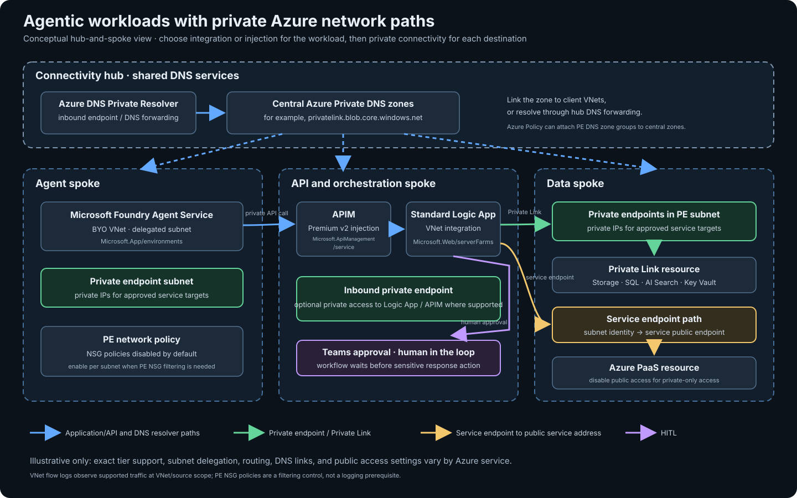
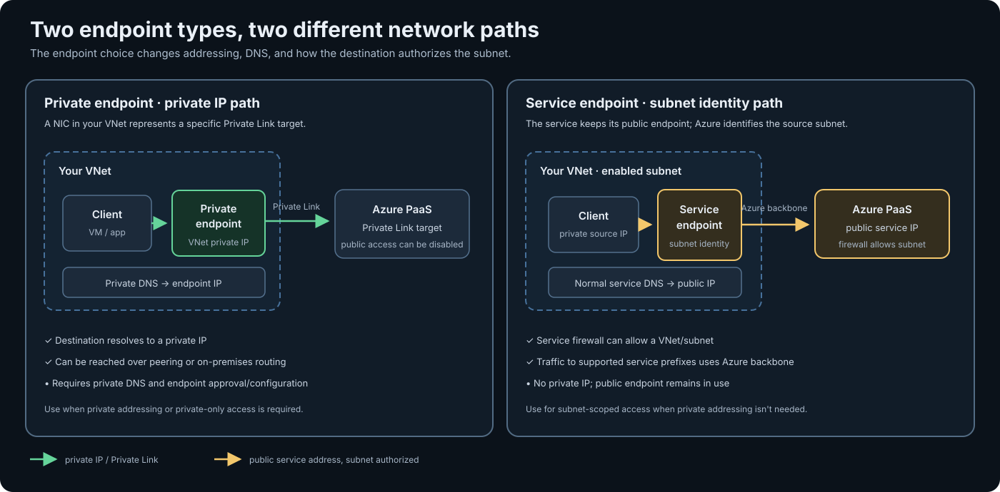
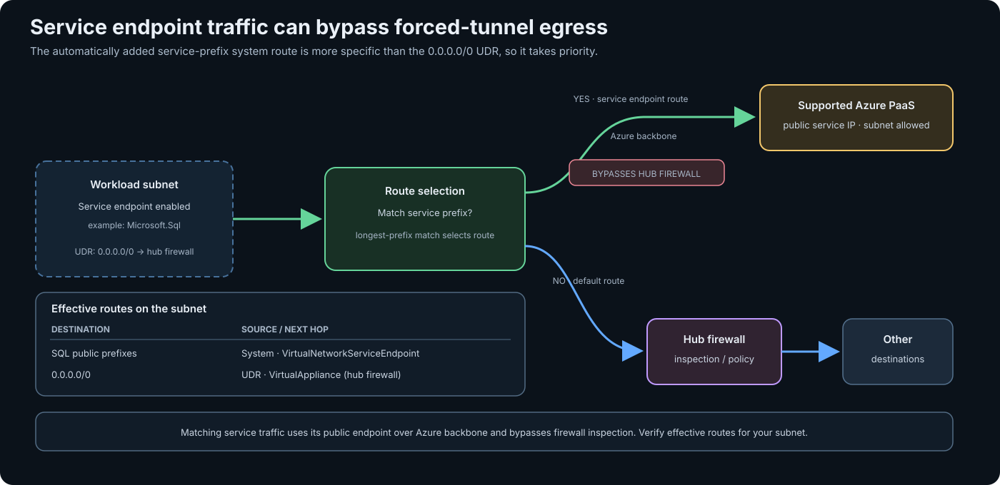

When customers ask me how to make an agentic workload "private," I start by sketching the traffic. Does the workload need to reach a private backend, should callers reach the workload privately, or do both paths need isolation? I find that one question clears up much of the terminology: Azure has several features with similar names, but they solve different parts of the path.

The useful mental model is simple:


*Integration and injection connect workloads with a VNet; private endpoints and service endpoints connect the VNet to services in different ways.*

The endpoint types are easy to mix up because both connect a VNet to an Azure service. This comparison shows what changes on the path: a private endpoint gives the target a private IP in your VNet, while a service endpoint keeps the service's public address and lets it authorize the source subnet.


*Private endpoints use a private IP and private DNS; service endpoints use the public service endpoint with subnet-based authorization.*

- **VNet integration** gives a supported workload a path into a VNet, usually for outbound access to private resources.
- **VNet injection** places or connects a service's components to a customer VNet or delegated subnet; inbound and outbound behavior depends on the service.
- **Private endpoints** connect a VNet to a service using a private IP.
- **Service endpoints** secure a subnet's access to a service that still has a public endpoint.

## 🧭 Start with the direction of traffic

| Feature | What it does | Typical use |
| --- | --- | --- |
| VNet integration | Gives a supported workload outbound reachability into a VNet and connected networks. | App Service or Standard Logic Apps calling a private database or API. |
| VNet injection | Places a service or its data-plane components into a customer VNet, according to that service's networking model. | APIM Premium v2 when both gateway ingress and backend egress need VNet isolation; Foundry Agent Service BYO VNet for isolated agent networking. |
| Private endpoint | Adds a private IP in your VNet for a specific Private Link target. | Private access to Storage, SQL, Foundry, Logic Apps, or an APIM gateway. |
| Private Link | The Azure connectivity capability behind private endpoints; also includes Private Link Service for exposing your own service privately. | Connect consumers to Azure services or publish a service behind a Standard Load Balancer to other VNets. |
| Service endpoint | Extends a VNet subnet's identity to a supported Azure service while the service keeps its public endpoint. | Lower-friction access restriction for a subnet to Storage or SQL when private IP addressing isn't required. |

> "Private" describes a network path, not the complete security posture. Keep authentication and authorization in place, and disable public network access on the destination where the design requires private-only access.
{: .prompt-warning}

## 📡 VNet integration and injection

**Integration is generally about outbound access.** For example, App Service and Standard Logic Apps can use VNet integration to call private endpoints, VMs, or services reachable through peering, VPN, or ExpressRoute. The integration subnet is dedicated and delegated according to the service's requirements. NSGs and route tables on it can control outbound traffic. They do not make the app's inbound endpoint private.

This is the mental model I use to start the discussion. The exact subnet rules still come from the service:

```text
Azure-managed service
        │
        ├── VNet integration
        │       Service stays on its platform network
        │       App gets a path into the VNet for outbound traffic
        │       Integration subnet is often delegated to the service
        │
        └── VNet injection
                Service-managed components are placed in the customer VNet
                Inbound and outbound behavior depends on the service
                Subnet is dedicated and/or delegated as required
```

Services with a VNet integration option include:

- **App Service**, including Web Apps, Azure Functions, and Standard Logic Apps.
- **API Management Standard v2 and Premium v2**, for outbound access to backends in a VNet. Their gateway endpoints remain public with integration.
- **Azure Container Apps environments**, with the networking options and requirements depending on the environment profile and workload profile.

Availability and subnet requirements vary by tier and hosting model, so check the service-specific page before designing around the label.

For the App Service family, routing is another setting to plan. VNet integration doesn't automatically send every outbound connection into the VNet: by default, private and service-endpoint traffic uses the integration path, while internet traffic goes directly out. Enable **Route All** when public egress must also traverse the VNet. NSGs and UDRs on the integration subnet affect traffic sent through that integration; a UDR can steer it through a firewall or gateway. This is still outbound routing, not inbound access control. Other services expose their own routing settings.

When you need centralized inspection, a UDR can steer integrated traffic through Azure Firewall or a network virtual appliance. For predictable outbound IPs without inspection, use a NAT Gateway where the service supports it. App Service also supports associating NAT Gateway with its integration subnet when Route All is enabled.

> **Injection is service-specific.** It usually means the service's network-facing components are deployed into, or connected directly to, a customer VNet/subnet. That can change inbound reachability as well as outbound routing.
{: .prompt-info}

Azure doesn't use "injection" as one consistent capability name across every service, so the examples below aren't a single exhaustive product feature:

- **API Management Premium v2** supports VNet injection for private gateway access and backend reachability.
- **Azure Databricks classic compute** supports VNet injection for customer-managed workspace networking.
- **Foundry Agent Service** supports a bring-your-own VNet setup for isolated agent networking.
- **Azure Container Apps environments** can be deployed with VNet integration/injection, depending on the environment configuration.
- **App Service Environment** is deployed into a VNet; it is distinct from the regional VNet integration feature used by multitenant App Service plans.

Microsoft's broader phrase for services that place service-managed instances in a VNet is **dedicated service deployment into a virtual network**. Quite a few Azure services use this pattern without consistently calling it "VNet injection." Keep it distinct from VNet integration, which generally gives an app outbound reachability into a VNet. Microsoft's [service networking matrix](https://learn.microsoft.com/en-us/azure/virtual-network/vnet-integration-for-azure-services) lists examples; check each product's current tier, region, subnet, and lifecycle requirements before designing around it.

The tier distinction matters: APIM Premium v2 injection provides a private gateway endpoint and backend reachability, while APIM Standard v2 VNet integration is outbound-only and leaves gateway endpoints public. The words alone don't tell you the boundary.

### APIM makes the distinction concrete

| | VNet integration | VNet injection |
| --- | --- | --- |
| Main purpose | APIM can reach private backends in the VNet. | The APIM gateway is deployed into a delegated VNet subnet. |
| Inbound private gateway access | ⛔ Public by default; integration alone doesn't make the gateway private. | ✅ Private gateway access through the VNet. |
| Outbound access to private backends | ✅ Yes. | ✅ Yes. |
| APIM presence in the customer subnet | ⛔ No injected gateway presence. | ✅ Yes. |
| Typical design | Public API gateway → private backend. | Private API gateway → private backend. |
| v2 tier availability | Standard v2 and Premium v2. | Premium v2. |

> Standard v2 and Premium v2 also support inbound private endpoints. That's a separate way to make gateway access private; VNet integration alone leaves the gateway public.
{: .prompt-warning}

**VNet integration is often entirely sufficient.** If the gateway can be public (with the usual authentication and policy controls) and the requirement is simply for APIM to call private backends, Standard v2 integration gives it that outbound path. You can also use an inbound private endpoint when callers need private access, without assuming that the gateway itself must be injected into the VNet. Premium v2 injection is for cases that need private inbound and outbound gateway traffic through the VNet; it doesn't place every APIM service component there.

Standard v2 and Premium v2 both support MCP and AI gateway features, as well as Agent 365 server inventory and blocking. Agent 365 tool-level controls and observability require the separate AI Gateway tier. Unless those capabilities drive the decision, choose between the v2 tiers based on the network boundary, scale, and other tier requirements. Check current support in the [APIM tier comparison](https://learn.microsoft.com/en-us/azure/api-management/api-management-features), [v2 networking](https://learn.microsoft.com/en-us/azure/api-management/virtual-network-concepts), [AI gateway](https://learn.microsoft.com/en-us/azure/api-management/genai-gateway-capabilities), and [Agent 365 capability table](https://learn.microsoft.com/en-us/azure/api-management/agent-365).

Foundry Agent Service is another example where the product term matters. Its BYO VNet option connects agent compute to a delegated subnet and is intended for isolated agent networking. It has account-level design implications, so decide on it before creating the account and first hosted agent. A private endpoint for the Foundry account by itself restricts inbound access; it doesn't turn off public agent egress. Foundry's managed virtual network has an `Allow only approved outbound` isolation mode, but that is a separate option you must select. A Foundry resource created without network configuration still has a public networking baseline.

## 🧱 Delegated subnets are service-specific

Some integration and injection models require a subnet delegation. Treat it as a service-specific subnet contract: Azure knows which service can place resources there, and the service defines whether the subnet must be dedicated, how large it must be, and whether sharing is allowed.

| Networking option | Subnet delegation in the documented model |
| --- | --- |
| Foundry Agent Service BYO VNet | `Microsoft.App/environments` |
| App Service, Functions, and Standard Logic Apps VNet integration | `Microsoft.Web/serverFarms` |
| APIM Standard v2 or Premium v2 outbound VNet integration | `Microsoft.Web/serverFarms` |
| APIM Premium v2 VNet injection | `Microsoft.ApiManagement/service` |

Subnet delegation doesn't have one universal sharing rule: the service decides whether its delegated subnet can host other supported resources or must be dedicated to that service. Other VNet deployment models, such as Azure Databricks VNet injection, have their own subnet rules and might not use delegation. Check the service-specific requirements before placing anything else in a delegated subnet.

> Private endpoints can't be created in delegated subnets. Use a separate, nondelegated PE subnet so its network policies can be managed independently from the workload subnet.
{: .prompt-warning}

## 🔐 Private endpoints, Private Link, and subnet NSGs

A **private endpoint (PE)** is a network interface with a private IP from your subnet, mapped to a specific target resource and subresource through Private Link. Clients still use the service's normal hostname; private DNS must resolve that name to the PE address. A PE can connect to supported Microsoft services or to a customer-owned Private Link Service. The service provider can approve or reject the connection.

Private endpoints are often a fairly direct addition: create the endpoint in a suitable, nondelegated subnet, approve the connection if needed, and set up name resolution. The client doesn't need VNet integration just because the target has a PE. It does need network reachability to the endpoint's VNet, and DNS must return the PE's private IP. A workload such as App Service may need VNet integration to reach that private IP, but that's a requirement of the workload's path into the VNet, not a prerequisite for creating the PE.

DNS is the part I check early because the service's usual hostname can continue resolving to its public address if private DNS isn't configured correctly. In a common enterprise hub-and-spoke design, the private DNS zones are managed centrally in the hub or a shared services subscription, while the private endpoints live beside the workloads in spoke VNets. The zone must still be visible to every network whose clients need to resolve the endpoint: link the zone to those VNets, or use a central DNS resolver and forwarding design that can resolve it. A zone existing in the hub alone doesn't make its records resolvable from every spoke automatically.

> **Private Link** is the connectivity feature that makes this work across the Microsoft backbone. Private Link Service is the provider side for your own service, typically behind a Standard Load Balancer. In short: consumers create private endpoints; providers expose a target through a Private Link-capable resource.
{: .prompt-info}

> PE subnet network policies are **disabled by default**. So, by default, an NSG associated with the PE subnet does not filter traffic to the private endpoints in it; the source subnet's NSG can still filter outbound traffic. 
{: .prompt-warning}

To have the PE subnet NSG filter traffic to its endpoints, enable `privateEndpointNetworkPolicies` for NSGs (or enable both NSG and route policies). This is a subnet-level setting and applies to every PE in that subnet. Then write inbound NSG rules for the PE destination IPs and required ports. Keep in mind that this controls traffic reaching the PE; it does not turn off the service's public endpoint. Also check the target service's own public access setting.

Enable PE subnet network policies when you need NSG or UDR enforcement at the endpoint subnet; the setting applies to every PE in that subnet and doesn't disable the service's public endpoint. Flow logs are a separate concern: they can't capture traffic at the PE itself, but supported VM sources can record traffic to a PE. Azure-managed services such as App Service, Functions, Logic Apps, and Container Apps aren't supported VNet flow log sources, so validate visibility for the actual workload type.

## 🧩 Service endpoints

> A service endpoint does **not** put a private IP for the service in your VNet. The service still uses its public endpoint address, while Azure identifies traffic from the configured subnet over the Azure backbone. 
{: .prompt-info}

You then configure the target service's network rules to allow that subnet. This is a reasonable choice when you want subnet-based restriction and don't need a private endpoint address or on-premises access to the service through the VNet.

Choose a private endpoint when you need a private IP, private DNS resolution, access from on-premises or peered networks, or tighter isolation at the individual resource level. Choose a service endpoint when the supported service and your connectivity needs fit its simpler subnet-identity model. Neither removes the need for service-level identity controls.

A service endpoint does not create a per-resource private connection: the destination still has to allow the subnet, and the service's own authorization still applies. For Azure Storage, a **service endpoint policy** can further limit which storage accounts are reachable through the endpoint. Use a private endpoint when you need the network path itself to target a specific resource.

### How service endpoints are routed

> Disclaimer: this routing section combines field experience with the Microsoft Learn pages on service endpoints, traffic routing and Azure Monitor network access. Docs and service tags change, so check the effective routes on your own NICs before relying on it.
{: .prompt-warning}

Enabling a service endpoint makes Azure add **system routes** to that subnet's route table: one per public prefix of the service, next hop `VirtualNetworkServiceEndpoint`. You don't create or manage them. For Azure SQL, enabling `Microsoft.Sql` adds the SQL prefixes.

This can improve the path for supported PaaS traffic in a forced-tunnel design: the matching service-prefix route is more specific than the default route to the hub firewall, so Azure sends that traffic directly over the backbone. It reduces the extra firewall hop, but also means that flow bypasses firewall inspection and logging.


*Supported service traffic follows the more-specific service endpoint route; other traffic continues to the hub firewall.*

These routes are more specific than the `0.0.0.0/0` a secured hub pushes to its spokes, so longest-prefix match wins. SQL traffic goes straight over the backbone and **skips the hub firewall**. The service sees the VNet's private IP as the source, and its network rules decide whether the subnet is allowed.

```text
Effective routes on the subnet
  10.0.0.0/16      VirtualNetwork
  <SQL prefixes>   VirtualNetworkServiceEndpoint   ← auto-added
  0.0.0.0/0        VirtualAppliance (hub firewall)

SQL traffic        → backbone, no firewall hop
Everything else    → hub firewall
```

> A UDR can't override these routes. If the firewall must see traffic to a service, don't enable the endpoint on that subnet, or use a private endpoint instead.
{: .prompt-warning}

### Services without a service endpoint

Service endpoints exist only for a fixed set of services: Storage, SQL, Key Vault, Event Hubs, Service Bus, Cosmos DB and a few others. Azure Monitor and Log Analytics aren't among them. Without an endpoint there are no system routes, so the traffic follows `0.0.0.0/0` to the hub firewall. Your options:

| Option | How it works | Trade-off |
| --- | --- | --- |
| **Private endpoint** (Azure Monitor: AMPLS) | Private IP in your VNet plus private DNS. | Most isolated, but more DNS work. AMPLS access modes decide whether the networks can still reach non-AMPLS resources. |
| **UDR: service tag, next hop `Internet`** | Routes matching traffic (for example, `AzureMonitor`) directly from the subnet. An associated NAT Gateway can SNAT it for VMs without individual public IPs. | Skips firewall inspection. The route doesn't provide SNAT by itself; use NAT Gateway or another outbound method when the subnet has no default outbound access. |
| **Keep it on the firewall** | Allow the service with an FQDN or service tag rule. | Full inspection and logging, but firewall load and cost grow with volume. |
| **NAT Gateway** | Predictable public egress IP and scalable SNAT for traffic routed directly to the internet. | Doesn't provide private access or override a UDR that sends traffic to a firewall. |

> For a log collector subnet I'd pick the service-tag UDR. It's more specific than the hub's `0.0.0.0/0`, so only Azure Monitor traffic goes straight out and everything else stays on the firewall. Verify the effective routes on the NIC afterwards.
{: .prompt-tip}

- Microsoft maintains the prefixes behind the tag, so the UDR needs no updates. A route table allows up to 25 service-tag routes, and tags like `VirtualNetwork`, `AzureLoadBalancer` and `Internet` can't be used in UDRs.
- Next hop `Internet` selects the direct route and bypasses the appliance; it doesn't itself provide SNAT. If the subnet has a NAT Gateway, the gateway SNATs this traffic to its public IP without requiring a public IP on each VM. Otherwise, the VM needs another outbound method, such as a public IP or load balancer outbound rule. Traffic to Azure service public IPs stays on the Azure backbone. New VNets default to private subnets, so don't assume default outbound access is available.
- Azure Monitor Agent needs both the `AzureMonitor` and `AzureResourceManager` tags. Tags don't cover data collection endpoint (DCE) IPs, so allow those separately.

## 🤖 Agentic patterns that make the choice concrete

**Foundry agent reads private enterprise data.** For a quick prototype, public egress may be acceptable while Storage, Search, or SQL are protected with private endpoints and appropriate DNS. For stronger egress isolation, choose Foundry's managed virtual network or BYO VNet model based on whether you need to manage address space, routing, and private connectivity yourself. If users must reach the Foundry endpoint privately, configure its inbound private endpoint too. Treat inbound and outbound choices as separate decisions.

**APIM fronts tools and agent backends.** If only APIM's backend calls need VNet reachability, Standard v2 integration is often enough, including for the listed AI gateway and MCP capabilities. Add an inbound private endpoint if callers also need private access. Choose Premium v2 injection when the gateway needs private inbound and outbound paths through the VNet, or when its scale ceiling and other Premium capabilities justify it. Check tier-specific compatibility before combining an inbound private endpoint with injection.

**Logic Apps handles human approval (HITL).** A Standard Logic App can use VNet integration for outbound calls to private APIs or data stores. If the workflow's HTTP endpoint or MCP server should only be called from private networks, add an inbound private endpoint and disable public access as appropriate. The workflow can still send an approval card to Teams and wait for a human decision; networking controls who can reach the workflow, while the approval step controls whether the sensitive action runs.

## ⚠️ Product boundaries to verify

Treat the architecture above as a guide to the paths, not as a deployment blueprint. Azure doesn't apply the terms *integration* and *injection* consistently across products, and a feature can be limited to specific tiers, regions, or deployment modes. Verify the service's current networking page, subnet delegation and sizing requirements, DNS behavior, and whether inbound and outbound isolation are both covered. A private endpoint also doesn't disable the target's public endpoint by itself.

## 📝 Conclusion

Map the required traffic direction first, then choose the product-specific feature: integration for outbound reachability, injection for a service's VNet placement and network boundary, private endpoints for private access to a target, and service endpoints for subnet-scoped access over a public service endpoint.

For service endpoints, remember the routing side effect: the auto-injected system routes are more specific than a forced-tunnel `0.0.0.0/0`, so that traffic bypasses the hub firewall. For services without a service endpoint, choose between a private endpoint, a service-tag UDR with next hop `Internet`, or keeping the traffic on the firewall.

For every private endpoint design, check DNS, the target's public network access setting, connection approval, and whether its subnet should enforce NSG rules. Those details decide whether the traffic follows the path the diagram claims.

## 📚 Microsoft documentation

- [Private endpoints and Private Link](https://learn.microsoft.com/en-us/azure/private-link/private-endpoint-overview/)
- [Private Link global reach and cross-region connectivity](https://learn.microsoft.com/en-us/azure/private-link/private-link-overview/)
- [Private endpoint DNS integration scenarios](https://learn.microsoft.com/en-us/azure/private-link/private-endpoint-dns-integration)
- [Private Link and DNS integration at scale with Azure Policy](https://learn.microsoft.com/en-us/azure/cloud-adoption-framework/ready/azure-best-practices/private-link-and-dns-integration-at-scale)
- [Private endpoint network policies](https://learn.microsoft.com/en-us/azure/private-link/disable-private-endpoint-network-policy)
- [Foundry Agent Service networking options](https://learn.microsoft.com/en-us/azure/foundry/agents/concepts/networking-options)
- [Set up private networking for Foundry Agent Service](https://learn.microsoft.com/en-us/azure/foundry/agents/how-to/virtual-networks)
- [APIM v2 VNet integration and injection](https://learn.microsoft.com/en-us/azure/api-management/integrate-vnet-outbound)
- [APIM tier feature comparison](https://learn.microsoft.com/en-us/azure/api-management/api-management-features) and [Agent 365 supported capabilities](https://learn.microsoft.com/en-us/azure/api-management/agent-365)
- [Service endpoints overview](https://learn.microsoft.com/en-us/azure/virtual-network/virtual-network-service-endpoints-overview)
- [Service endpoint policies](https://learn.microsoft.com/en-us/azure/virtual-network/virtual-network-service-endpoint-policies)
- [Virtual network traffic routing](https://learn.microsoft.com/en-us/azure/virtual-network/virtual-networks-udr-overview)
- [Azure Monitor Private Link Scope](https://learn.microsoft.com/en-us/azure/azure-monitor/fundamentals/private-link-security)
