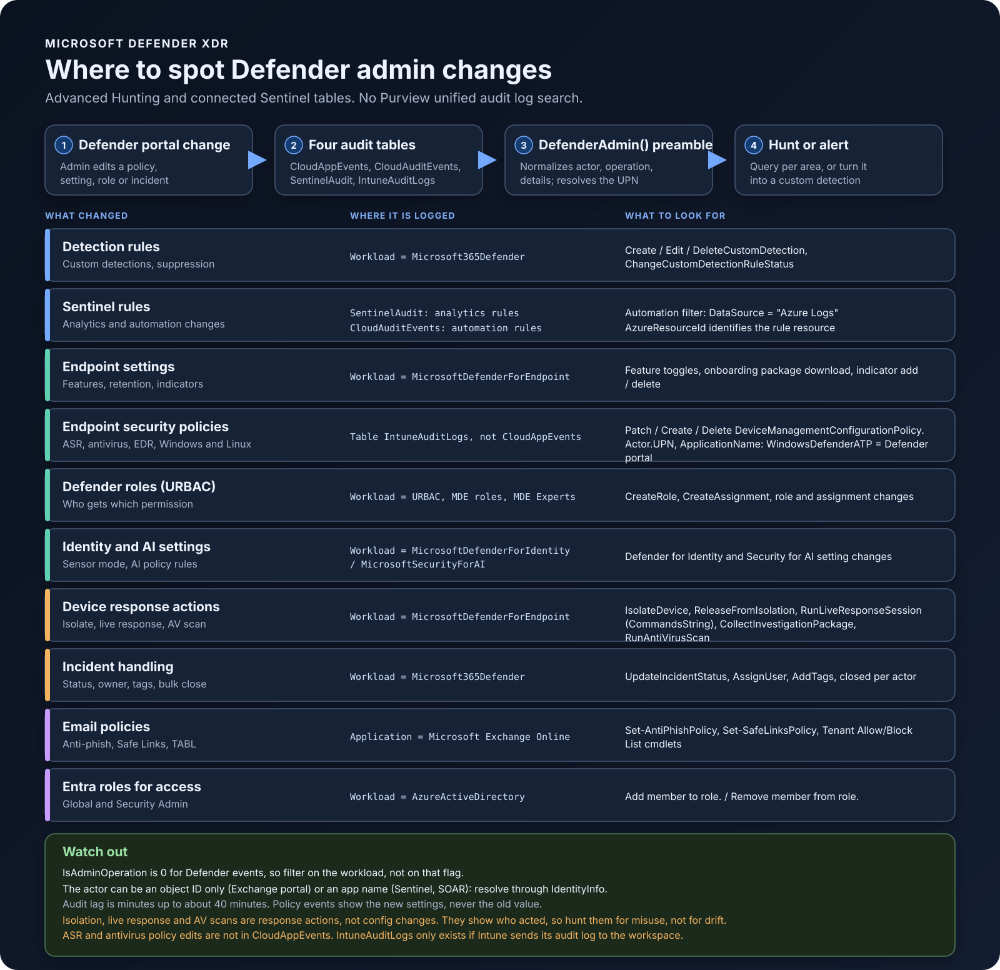

When someone changes a Defender setting, disables a detection, runs live response, or closes a pile of incidents, I want one practical answer: who did it, what changed, and when? The Purview audit experience remains the broader audit record, but I also want to investigate these changes where I already hunt: Microsoft Defender Advanced Hunting. It turns out that a useful admin activity view can be built there, as long as I treat it as a focused operational hunt and stay honest about the gaps.

Hunting Defender administration through Advanced Hunting is not a new idea. I wanted to take another look at the events and fields available in my test tenant, and collect the queries into one practical reference. This pass is not exhaustive; I may have missed operations or settings that are audited in other environments. I’m sharing what I have so far as a useful starting point, and I expect the query set to grow as I validate more activity.

> I put the full query set in [my GitHub repository](https://github.com/pisinger/hunting/blob/main/defender-admin-audit-hunting.md). This post explains the design choices that matter and the signals I would start with; it does not reproduce all 18 queries.
{: .prompt-tip}

## 🔍 The data is there, but it is spread out

There is no single Defender admin audit table. Most Defender XDR portal actions in this set arrive in `CloudAppEvents`, with the workload and operation stored in `RawEventData`. Exchange Online cmdlets used to manage Defender for Office 365 policies also appear in `CloudAppEvents`, but as Exchange activity. Entra role changes are another workload. Sentinel analytics rule changes come from `SentinelAudit`, and endpoint security policies managed through Intune are in `IntuneAuditLogs` when that table is connected to the workspace.

That spread is manageable if the goal is to hunt across the products that control Defender. It is also a useful reminder that the portal’s audit experience and Advanced Hunting are different views over different access paths. Microsoft documents `CloudAppEvents` as a cloud-app activity table, and its availability depends on the relevant Microsoft 365 activity connection being configured in Defender for Cloud Apps. Check that prerequisite in your tenant before interpreting an empty result as “nothing happened.” <https://learn.microsoft.com/en-us/defender-xdr/advanced-hunting-cloudappevents-table>

The same workload-first extraction pattern appears in this [practitioner write-up on auditing Defender XDR activities](https://kqlquery.com/posts/audit-defender-xdr/). I use the operation inventory in my query set for the same practical reason: confirm what your tenant emits before building an alert around it.



## 🧭 Start with the event shape, not an admin flag

The most consequential finding in my test tenant was that `IsAdminOperation` was `0` for Defender portal events. A query that begins with `IsAdminOperation == true` can therefore filter out the very Defender changes we are trying to find. Instead, the shared function parses `RawEventData`, selects the relevant `Workload` values, and then derives an actor from the account fields, the raw user ID, and `IdentityInfo`.

Actor attribution needs care. An incident update made by Sentinel or a SOAR integration may not have an account ID or display name at all; the client application name can be in `AppAccessContext`. `UserType` is not consistent enough to identify a human administrator by itself either. In the examples I tested, the same admin appeared with different user types across workloads. The function classifies obvious application names first, then uses `UserType` as a hint. That makes `ActorKind` useful for triage, not an authoritative identity verdict.

Here is the common preamble used by the focused hunts. It resolves object IDs against `IdentityInfo`, exposes a consistent actor view, and leaves operation-specific fields in `Details` for the query that follows.

```shell
let DefenderAdmin = (lookback: timespan) {
    let identities = IdentityInfo
        | where Timestamp > ago(30d)
        | summarize arg_max(Timestamp, AccountUpn, AccountDisplayName) by AccountObjectId
        | project IdentityObjectId = AccountObjectId, IdentityUpn = AccountUpn, IdentityName = AccountDisplayName;
    CloudAppEvents
    | where Timestamp > ago(lookback)
    | extend R = parse_json(RawEventData)
    | extend Workload = tostring(R.Workload)
    | where Workload in ("Microsoft365Defender", "MicrosoftDefenderForEndpoint", "MicrosoftDefenderExperts", "URBAC",
        "MicrosoftDefenderForIdentity", "MicrosoftSecurityForAI")
    | extend RawUser = tostring(R.UserId)
    | extend ActorObjectId = coalesce(AccountObjectId,
        extract(@"/([0-9a-f]{8}-[0-9a-f-]{27})$", 1, RawUser),
        extract(@"^([0-9a-f]{8}-[0-9a-f-]{27})$", 1, tostring(R.UserKey)))
    | join kind=leftouter identities on $left.ActorObjectId == $right.IdentityObjectId
    | extend ActorName = coalesce(AccountDisplayName, IdentityName,
        tostring(R.AppAccessContext.ClientAppName), RawUser, "(unknown)")
    | extend ActorUpn = tolower(coalesce(iff(RawUser contains "@", RawUser, ""),
        IdentityUpn, iff(AccountId contains "@", AccountId, "")))
    | extend Actor = coalesce(ActorUpn, ActorName)
    | extend ActorKind = case(
        ActorName startswith "API-App:" or ActorName startswith "Microsoft 365 Defender-" or ActorName =~ "system", "application",
        toint(R.UserType) in (2, 7), "admin",
        toint(R.UserType) in (5, 6), "application",
        toint(R.UserType) == 4, "system",
        toint(R.UserType) == 0, "user",
        "other")
    | extend Details = bag_remove_keys(R, dynamic(["CreationTime", "Id", "OrganizationId", "UserKey", "UserType", "Workload",
        "RecordType", "ClientIP", "UserId", "Operation", "ActorContextId", "AppAccessContext"]))
    | project Timestamp, ReportId, Workload, Operation = ActionType, Actor, ActorUpn, ActorName, ActorKind,
        ActorObjectId, IPAddress, CountryCode, Details
};
```

The same principle applies to event details. The shared function keeps the raw operation-specific properties in `Details` instead of pretending that every workload has a neat, stable schema. That lets a first pass show what the event contains; then a tenant-specific detection can extract the fields it actually needs.

For example, once the function is defined, this small hunt surfaces custom detection changes. The full query projects rule names, IDs, severity, frequency, and a snippet of the rule query.

```shell
DefenderAdmin(30d)
| where Operation in ("CreateCustomDetection", "EditCustomDetection", "DeleteCustomDetection",
    "ChangeCustomDetectionRuleStatus", "RunCustomDetection")
| project Timestamp, Operation, Actor, ActorKind, IPAddress,
    RuleId = tostring(Details.RuleId), RuleName = tostring(Details.RuleName)
| order by Timestamp desc
```

The test tenant returned one rule creation and a later manual run. The rule query itself was present on the create event, which makes the audit record useful for understanding what a deleted or changed detection covered.

```text
Timestamp            | Operation              | Actor    | Rule name              | Severity | Frequency
---------------------+------------------------+----------+------------------------+----------+----------
2026-10-27 15:46:28Z | CreateCustomDetection  | Admin    | After-hours Copilot u… | Medium   | 1H
2026-11-02 21:04:31Z | RunCustomDetection     | Admin    | After-hours Copilot u… | —        | —
```

This is another useful first query: find which operations are actually present before relying on one as a detection signal.

```shell
DefenderAdmin(30d)
| summarize Events = count(), Actors = make_set(Actor, 5), First = min(Timestamp), Last = max(Timestamp)
    by Workload, Operation
| order by Workload asc, Events desc
```

All result examples below are generalized; the counts come from the test tenant. Its inventory showed that incident and case operations dominated the event count, while configuration changes were comparatively sparse. A few examples:

| Workload | Operation | Events | Example actor |
|---|---|---:|---|
| `Microsoft365Defender` | `AddedCommentToCase` | 187 | SOAR application |
| `Microsoft365Defender` | `CreateCustomDetection` | 1 | Admin |
| `MicrosoftDefenderForEndpoint` | `SetAdvancedFeatures` | 2 | Admin |
| `MicrosoftDefenderForIdentity` | `RemediationActionConfigurationUpdated` | 4 | Admin |

That difference matters when tuning: an actor summary without an operation breakdown mostly describes automation moving incidents around, not administrators changing security controls.

The actor inventory made the same point from another angle: the Sentinel integration generated 1,923 events across nine operations, while two human admins generated 47 and 41 events. One agent appeared as a regular `user`, not an `admin`, under the event's `UserType`. Filter by observed behavior and actor context; do not treat that field as a definitive human-versus-application label.

## 🛠️ Hunt the changes that matter first

I would begin with coverage and actor inventory, then focus on changes that can remove visibility or expand access. In the supplied query set, the most useful starting points are:

- **Detection changes:** custom detection rules created, edited, deleted, or switched on and off; plus suppression rule changes.
- **Coverage and exclusions:** advanced feature or data-retention changes, offboarding packages, indicators with an allow action, Defender for Identity exclusions, and Security for AI protection changes.
- **Access changes:** Defender Unified RBAC role and assignment operations, plus Entra roles that grant Defender access.
- **High-impact actions:** live response, device isolation, file downloads, and other response operations, with comments and device context where available.
- **Email and Sentinel controls:** Exchange policy changes and allow-list entries, Sentinel analytics rule changes or deletions, and automation rule changes.

One Sentinel detail is easy to miss: `SentinelAudit` is useful for analytics rule changes, but Microsoft's current audit reference says its audit feature supports only the analytics rule resource type. Automation rule changes are control-plane operations. In Advanced Hunting, find them in `CloudAuditEvents` where `DataSource` is `Azure Logs`; the automation rule path is in `AzureResourceId`:

```shell
CloudAuditEvents
| where Timestamp > ago(30d)
| where DataSource =~ "Azure Logs"
| where OperationName contains "Microsoft.SecurityInsights/automationRules"
| extend RuleId = extract(@"(?i)/automationRules/([^/?]+)", 1, AzureResourceId),
         Status = tostring(RawEventData["status"]),
         SubStatus = tostring(RawEventData["subStatus"])
| project Timestamp, ActionType, OperationName, RuleId, AzureResourceId,
          IPAddress, Status, SubStatus, RawEventData, AdditionalFields
| order by Timestamp desc
```

The `CloudAuditEvents` table must be available in Advanced Hunting. In this query, `OperationName` identifies the automation-rule operation and `AzureResourceId` identifies the resource. Inspect `RawEventData` and `AdditionalFields` for event-specific actor and status fields; their shape can vary. [CloudAuditEvents schema](https://learn.microsoft.com/en-us/defender-xdr/advanced-hunting-cloudauditevents-table) [Sentinel audit table reference](https://learn.microsoft.com/en-us/azure/sentinel/audit-table-reference)

The tested `SentinelAudit` analytics-rule results also show why caller context matters. One generalized application ID was associated with 674 successful creates or updates, 607 failed saves, and 200 deletions in the sample window. That looks consistent with a detections-as-code deployment, but the caller still needs to match the pipeline you expect. The automation-rule query above was not exercised in the original test tenant, so inspect the event payload in your workspace before relying on actor or status fields for alerting.

The first two queries in the repository are intentionally unglamorous: find which operations your tenant actually emits, and identify who is generating them. They keep you from building a detection around an operation your tenant never records, and they help separate a person from the Sentinel integration that routinely updates incidents.

For behavior hunting, I would add a few narrow questions: did a non-application actor make configuration changes from a new location, outside the expected work window, or in a short burst? Did one person close many incidents quickly? These are prompts for investigation, not verdicts. In my test tenant, a pipeline-like application generated hundreds of Sentinel rule deletions, while routine Defender service activity also produced noisy Exchange audit events. Baselines need to recognize expected automation and service accounts before those queries become useful alerts.

## ⚠️ Good enough depends on the audit question

Advanced Hunting is convenient because the query, investigation, and any custom detection can live in the Defender workflow. The usual Advanced Hunting window is 30 days, with an ISOC retention benefit for eligible customers.

> **ISOC retention disclaimer:** The included retention benefit is available only to eligible Microsoft Defender Suite, Microsoft 365 E5, and Microsoft 365 E7 customers. Starting November 15, 2026, it provides up to 90 days for supported, built-in Microsoft Defender workload data. Coverage is table-specific: `CloudAppEvents`, the main source for the Defender portal events in this post, is included, while `IdentityInfo`, `SentinelAudit`, and `IntuneAuditLogs` are not in Microsoft's current included-table list. Do not assume every table in a query has the same history. Microsoft expects the full 90-day history for data covered by the current rollout by January 3, 2027. Custom Sentinel tables and additional data connected through an ISOC workspace have separate ingestion and retention terms. Check eligibility, the current table list, and the actual dates available in your tenant before extending a hunt's lookback. [ISOC retention guidance](https://learn.microsoft.com/en-us/defender-xdr/integrated-security-operations-data-billing-retention); [Sentinel table retention guidance](https://learn.microsoft.com/en-us/azure/sentinel/manage-table-tiers-retention).
{: .prompt-warning}

Outside that ISOC benefit, supported Defender XDR hunting tables can be retained longer by onboarding a Microsoft Sentinel workspace and configuring their analytics-tier retention. Purview Audit Standard has a separate retention policy, currently 180 days by default, with longer options available under applicable licensing and policies. These are different retention models, so I would not use an Advanced Hunting query as the only long-term audit archive. <https://learn.microsoft.com/en-us/defender-xdr/advanced-hunting-overview> <https://learn.microsoft.com/en-us/purview/audit-log-retention-policies>

For customers outside that ISOC benefit, supported Defender XDR hunting tables can be retained longer by onboarding a Microsoft Sentinel workspace and configuring their analytics-tier retention. Purview Audit Standard has a separate retention policy, currently 180 days by default, with longer options available under applicable licensing and policies. These are different retention models, so I would not use an Advanced Hunting query as the only long-term audit archive. <https://learn.microsoft.com/en-us/defender-xdr/advanced-hunting-overview> <https://learn.microsoft.com/en-us/purview/audit-log-retention-policies>

There are other limits in the query set itself. Some event operations were documented but did not occur in the test tenant, so those queries still need validation against real events. Some configuration events arrive with a delay. Some settings are not audited at all. Intune-managed endpoint policies and Sentinel analytics rules need their own data sources. A missing row does not prove the setting was unchanged.

That is why I would describe this as **admin audit hunting**, not a replacement for the unified audit log. For routine SOC questions—who changed a Defender detection, which admin performed a response action, or whether a risky policy or role change needs review—it can be good enough, and it keeps the investigation close to the alerts and devices affected. For completeness, compliance retention, or incident reconstruction beyond the available window, keep Purview and the appropriate long-term collection path in the picture.

> The full query set includes additional hunts for roles, response actions, Intune policy changes, Exchange policies, Sentinel analytics rules, and behavior baselines. Start with the coverage query in your own tenant and validate the actual operation names and `Details` fields before turning any result into an alert.
{: .prompt-tip}

## 📝 Conclusion

Defender Advanced Hunting can answer many practical questions about Defender administration without making every investigation start in Purview. The useful boundary is clear: use it to hunt and operationalize the admin activity that reaches the Defender data you have connected, and use Purview as the broader audit record. The [repository queries](https://github.com/pisinger/hunting/blob/main/defender-admin-audit-hunting.md) are a starting point; tenant validation is part of making them trustworthy.
