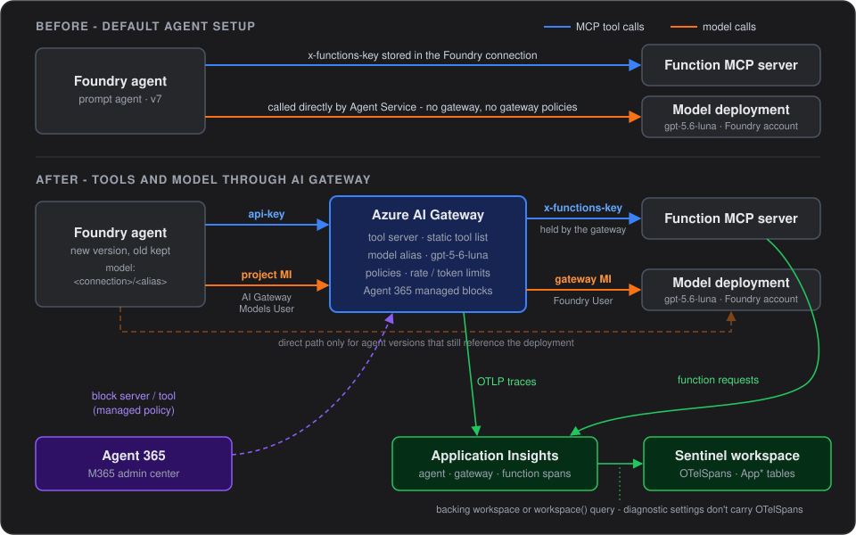
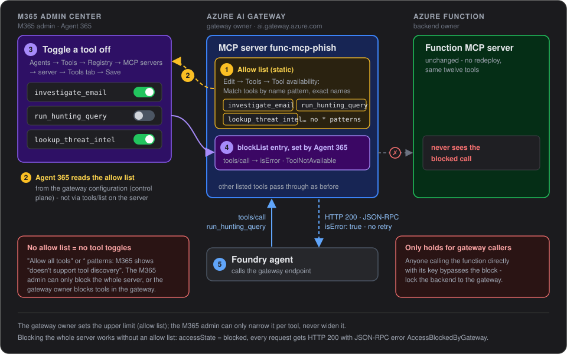
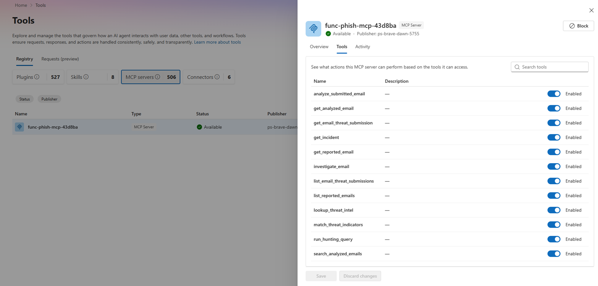
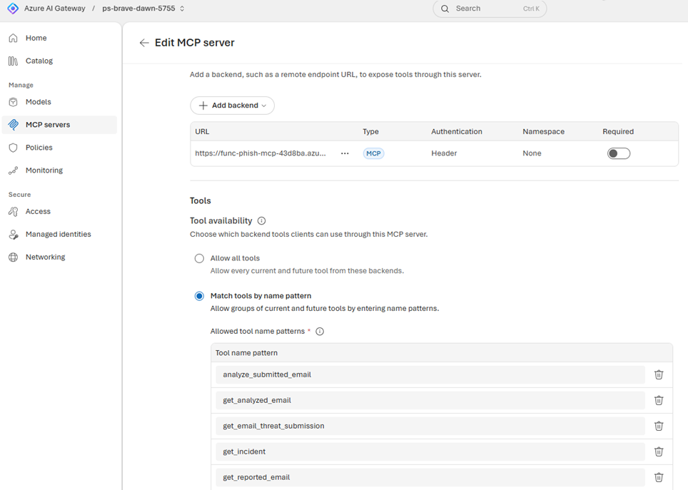
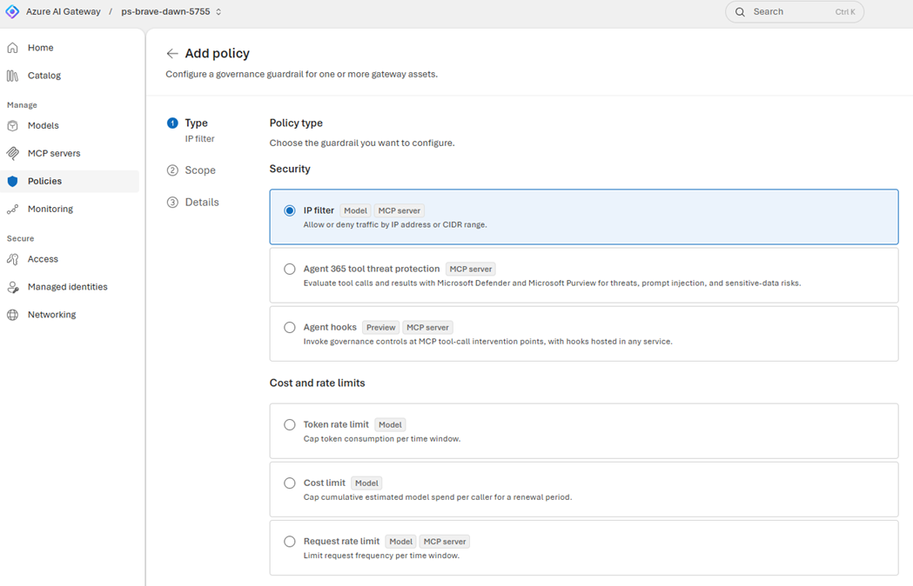

Most agents that use MCP tools call their MCP servers directly. It works, but nothing sits in between: no central place to switch off a single tool, no inventory an M365 admin can see, and the only logs are whatever each server writes. With **Microsoft Agent 365** now able to discover and govern MCP servers behind **Azure AI Gateway**, that missing layer finally exists. I wanted to see it end to end: deploy the gateway, move an existing Foundry agent and its MCP server onto it, block tools from the M365 admin center - and find out how much that block is actually worth. The gateway's telemetry beyond governance - tool calls, tokens, cost and the missing client IP - got its own post: [Hunting Azure AI Gateway Telemetry](/posts/azure-ai-gateway-telemetry-kql-otelspans-tokens-client-ip/).

> I've been waiting for this for a while. Every new agent, model deployment and MCP server comes with its own auth and its own logs - if any. For Sentinel and Defender, that means collecting telemetry workload by workload. A central gateway for models *and* tools is what I always wanted: one place to enforce, one place to switch things off, one log stream to bring in - with agents told apart by name and a run traceable from model call to tool call and back. And I want that control to reach **Microsoft 365**: the gateway's MCP servers and tools in the M365 admin center through Agent 365, right next to the agents, so an admin can switch off a single tool without opening the Azure portal. For me, that's the key change from the AI capabilities in API Management to the dedicated AI Gateway. So I wanted to see how far AI Gateway gets there - and where it doesn't (yet).
{: .prompt-info}

My sample is a Foundry agent with one MCP tool - an Azure Function wrapping Defender XDR, Graph and Defender TI lookups - but the steps are the same for any agent calling MCP tools - including the two auth details that cost me the most time.


_Before and after: tool calls and model calls both go through the gateway, each hop with its own credential. Agent 365 writes its blocks into the gateway, and the traces land next to the function's in Application Insights - and from there in Sentinel._

## 🧭 AI Gateway vs. API Management - Which One Agent 365 Wants

Two products are in play, and the naming makes it easy to mix them up. **Azure API Management** (the service you know, v1 and v2 tiers) has "AI gateway capabilities". **Azure AI Gateway** is a separate, dedicated product for model and MCP traffic - same `Microsoft.ApiManagement` resource provider, different resource type, and its own portal at `ai.gateway.azure.com`.

Microsoft draws the line like this: both belong to the same product family and AI Gateway builds on the API Management gateway foundation, but the two have distinct scopes and roadmaps.

- **Azure AI Gateway** is the dedicated product for AI traffic. Platform teams publish approved models and tools, control access and consumption, and observe their use across applications and agents.
- **AI gateway capabilities in Azure API Management** extend the API management model to AI backends. Teams manage model endpoints, MCP servers and other AI endpoints *alongside* their regular APIs. These capabilities stay available and supported.

Put simply: if AI traffic is one more API type in an existing APIM estate, the APIM capabilities are fine. If you want a central AI control plane - with tool-level governance surfacing in M365 - it's AI Gateway.

For Agent 365, the difference is not cosmetic:

| Capability                               | APIM v2 tiers | AI Gateway tier |
| ---------------------------------------- | :-----------: | :-------------: |
| Central MCP server inventory             | ✅            | ✅              |
| Block / unblock a whole MCP server       | ✅            | ✅              |
| Tool-level blocking                      | ⛔            | ✅              |
| Tool activity observability              | ⛔            | ✅              |
| Tool threat protection (Defender/Purview)| ⛔            | ✅              |

APIM v1 tiers aren't supported at all. If you want to switch off a single tool rather than the whole server, AI Gateway is the only option today.

> **Update (November 2026):** Microsoft announced the Agent 365 integration with Azure API Management and Azure AI Gateway as generally available in November 2026. Check the current [AI Gateway region list](https://learn.microsoft.com/azure/ai-gateway/region-availability) before you plan; the list I checked included **Sweden Central**, **West Europe** and **East US 2**. For pricing, see the [API Management pricing page](https://azure.microsoft.com/en-us/pricing/details/api-management). ([GA announcement](https://azure.microsoft.com/en-us/updates?id=580055))
> <https://learn.microsoft.com/azure/ai-gateway/region-availability>
> <https://learn.microsoft.com/azure/api-management/agent-365>
> <https://learn.microsoft.com/azure/ai-gateway/overview>
{: .prompt-info}

## 🛠️ Deploying the AI Gateway

My first instinct was to create it from the API Management blade in the Azure portal. That doesn't work - the APIM create wizard only offers the classic and v2 tiers. AI Gateway is created from its own portal (just like ACA Sandboxes), the `az aigateway` CLI extension, or ARM (see the CLI section further down).

Prerequisites before you start:

- `Microsoft.ApiManagement` resource provider registered (it wasn't in my lab subscription).
- `Contributor` on the target resource group.
- `Reader` and `User Access Administrator` on the Foundry account, so the gateway's managed identity can be granted access to model deployments.

In <https://ai.gateway.azure.com> it's **All gateways → Create gateway**, pick subscription, existing resource group and a supported region. There is no SKU picker - the resource comes back with `sku.name: Standard` - not to be confused with the classic APIM Standard tier.

```bash
az provider register -n Microsoft.ApiManagement

# what you get back
az resource show --ids "$GW_ID" --query "{type:type, sku:sku, host:properties.frontend.defaultHostname}"
```

```json
{
  "type": "Microsoft.ApiManagement/aigateways",
  "sku": { "name": "Standard" },
  "host": "aigw-demo-01-xxxxxxxx.swedencentral-01.ai.gateway.azure.com"
}
```

> Same as with API Management v2: outbound VNet integration can be added after creation, but once set, Learn says the virtual network and subnet can't be changed - so pick the final subnet up front. Inbound private endpoints are still in public preview and need approval ([request access](https://ai.gateway.azure.com/docs/networking/request-private-endpoint-access)); until then the gateway endpoint stays public.
> <https://learn.microsoft.com/azure/ai-gateway/ai-gateway-resource>
{: .prompt-info}

> The docs currently use both `Microsoft.ApiManagement/gateways` and `Microsoft.ApiManagement/aigateways`. The portal created `aigateways` for me. Gateways on the older AIGateway SKU of `Microsoft.ApiManagement/service` must migrate to the new resource type before **2027-01-15** - don't start new work on that one.
{: .prompt-warning}

## 🔗 Registering the MCP Server as a Tool Server

In the gateway, the Azure Function is added as a **tool server** with a remote MCP endpoint. The gateway holds the backend credential - in my case the `x-functions-key` header - so the agent never needs it again. The ARM view shows both sides: the backend endpoint and the gateway endpoint the agent will use.

```bash
az rest -m get -u "$GW_ID/toolServers?api-version=2026-11-01" \
  --query "value[].{name:name, backend:properties.endpoints[0].mcp.endpoint.url, gateway:properties.gatewayEndpoints[0].url}"
```

```json
[
  {
    "name": "func-mcp-phish",
    "backend": "https://func-mcp-phish.azurewebsites.net/runtime/webhooks/mcp",
    "gateway": "https://aigw-demo-01-xxxxxxxx.swedencentral-01.ai.gateway.azure.com/default/toolservers/func-mcp-phish/mcp"
  }
]
```

> Note what the tool server does *not* contain: a list of tools. Registered like this, it is a pass-through - the gateway forwards whatever the function returns from `tools/list`. That's fine for routing, but it matters later for per-tool blocking in the M365 admin center, which I come back to below.
{: .prompt-info}

## 🔐 Runtime Auth - the Two Details That Bit Me

Every gateway comes with a built-in `master` key ("all-access subscription"). I don't want the agent using that, so I created a dedicated runtime key per consumer:

```bash
az rest -m put -u "$GW_ID/apiKeys/foundry-phishing-triage?api-version=2026-11-01" \
  -b '{"properties":{"displayName":"Foundry agent phishing-triage"}}'

KEY=$(az rest -m post -u "$GW_ID/apiKeys/foundry-phishing-triage/listSecrets?api-version=2026-11-01" \
  --query primaryKey -o tsv)
```

Then the first surprise. The AI Gateway quickstart sends the key for model calls as `Authorization: Bearer <key>`. Against the MCP tool server endpoint, that returns `401`. Same for `x-api-key` and `Ocp-Apim-Subscription-Key`. The header that works is `api-key`:

```text
Header tried                    | Result
--------------------------------|-------------------------------------------------------------
Authorization: Bearer <key>     | 401  Missing or invalid Entra ID token, or missing Data.All…
x-api-key: <key>                | 401
Ocp-Apim-Subscription-Key       | 401
api-key: <key>                  | 200
Entra token (ai.gateway.azure…) | 403  authenticated, but no runtime role assigned
```

The second detail is in the last row: an Entra token for the `https://ai.gateway.azure.com` audience is accepted, but you need a runtime role on the gateway (**Access → Add role assignment → Allow these identities to invoke models and tools**). That's the path I'd take long-term with the Foundry project's managed identity - no shared secret in a connection. For the migration I stayed with the key to change one thing at a time.

A quick `tools/list` through the gateway confirms the whole chain before touching the agent:

```bash
URL="https://<gateway-host>/default/toolservers/func-mcp-phish/mcp"
H=(-H "Content-Type: application/json" -H "Accept: application/json, text/event-stream" -H "api-key: $KEY")

curl -s -X POST "$URL" "${H[@]}" -d '{"jsonrpc":"2.0","id":1,"method":"initialize","params":{"protocolVersion":"2025-06-18","capabilities":{},"clientInfo":{"name":"probe","version":"1"}}}' >/dev/null
curl -s -X POST "$URL" "${H[@]}" -d '{"jsonrpc":"2.0","id":2,"method":"tools/list"}' \
  | sed -n 's/^data: //p; /^{/p' | jq -r '.result.tools[].name'    # handles SSE and plain JSON responses
```

All twelve tools of the server came back - `investigate_email`, `run_hunting_query`, `lookup_threat_intel` and friends.

> If you'd rather click than `curl`: **MCP servers** → your server → **Test in catalog** is a proper MCP playground - pick API key or Entra ID, **Connect** lists the tools, then run one with a form. It goes through the gateway endpoint, so policies apply and it's logged like any agent call. Start with a read-only tool - a tool run is a real call against the backend.
{: .prompt-tip}

## 🤖 Switching an Existing Foundry Agent to the Gateway

The agent is a prompt agent with one MCP tool. Its connection (`CustomKeys`) held the function key and pointed at the function URL. The change is small: a new connection to the gateway, and a new agent version that references it. I deliberately did **not** edit the existing connection - the old version keeps working, and rolling back is just pointing callers at the previous version.

New project connection with the gateway key in the `api-key` header:

```bash
jq -n --arg t "$GW_MCP_URL" --arg k "$KEY" '{properties:{
  category:"CustomKeys", authType:"CustomKeys", target:$t, isSharedToAll:false,
  credentials:{keys:{"api-key":$k}}}}' > conn.json

az rest -m put -b @conn.json \
  -u "$PROJECT_ID/connections/phishing-triage-mcp-gw?api-version=2025-06-01"
```

New agent version - take the latest definition and swap only `server_url` and `project_connection_id` on the MCP tool, so the instructions and model stay byte-identical:

```bash
EP="https://<foundry-account>.services.ai.azure.com/api/projects/<project>"
TOK=$(az account get-access-token --resource https://ai.azure.com --query accessToken -o tsv)

curl -s "$EP/agents/phishing-triage?api-version=v1" -H "Authorization: Bearer $TOK" \
| jq --arg u "$GW_MCP_URL" '.versions.latest | {description, definition: (.definition
    | .tools |= map(if .type=="mcp" then .server_url=$u | .project_connection_id="phishing-triage-mcp-gw" else . end))}' \
| curl -s -X POST "$EP/agents/phishing-triage/versions?api-version=v1" \
    -H "Authorization: Bearer $TOK" -H "Content-Type: application/json" -d @- \
| jq '{version, tools: .definition.tools}'
```

```json
{
  "version": "7",
  "tools": [
    {
      "type": "mcp",
      "server_label": "defender_phishing",
      "server_url": "https://aigw-demo-01-xxxxxxxx.swedencentral-01.ai.gateway.azure.com/default/toolservers/func-mcp-phish/mcp",
      "require_approval": "never",
      "project_connection_id": "phishing-triage-mcp-gw"
    }
  ]
}
```

> Foundry caches connection credentials for about two minutes. If a freshly created or rotated key doesn't seem to work, wait before you start debugging headers.
{: .prompt-tip}

A read-only test run against version 7 - "list recent user-reported emails, recent submissions, and check the TI reputation of a host" - completed with three `mcp_call` items and no errors. That's the run you'll see in the [telemetry post](/posts/azure-ai-gateway-telemetry-kql-otelspans-tokens-client-ip/).

## 🎛️ Enabling Gateway Discovery in the M365 Admin Center

This is the step that turns the gateway into something an M365 admin can govern. It is a one-time, tenant-wide consent and requires **Global Administrator** - the AI Administrator role can't do it.

1. Sign in to `admin.microsoft.com` → **Agents** → **Settings** → **Gateways**.
2. Turn on **Microsoft Azure** (Azure API Management service and AI Gateway) and accept the permissions.
3. Go to **Agents** → **Tools** → **Registry** → **MCP servers** and refresh after a few minutes. Servers from the gateway show publisher **AI Gateway** - with or without an allow list.
4. Select the server: **Block** blocks the whole server and is always available. The **Tools** tab with per-tool toggles needs one more thing on the Azure side.

> **Under the hood, the toggle is an Azure role assignment on the tenant root management group** - that's how every AI Gateway in the tenant, current and future, is covered automatically. The Agent 365 service principal gets `A365 Gateway Policy Operator` (Learn: `A365 MCP Gateway Policy Operator`): read on all API Management and AI Gateway resources, **write** on their MCP servers and APIM APIs. It's flipped in the M365 admin center, so make sure the Azure platform team knows it's there.
{: .prompt-info}

Check whether it's already there:

```bash
az role assignment list --all --include-inherited \
  --query "[?contains(roleDefinitionName,'A365')].{role:roleDefinitionName, scope:scope, created:createdOn}" -o table
```


### Per-tool blocking - what to configure where

My first assumption was that the MCP server itself had to change. It doesn't - the function keeps serving its twelve tools. Agent 365 reads the **allow list on the gateway's MCP server**, not the backend's `tools/list`:


_① The gateway owner sets a static allow list, ② Agent 365 reads it from the gateway configuration, ③ the M365 admin toggles a tool off, ④ Agent 365 adds the tool to the server's `blockList`, ⑤ the agent gets `isError` back and the function never sees the call._

Without that list, the **Tools** tab says *"This server doesn't support tool discovery"* and only the server-level block remains. To set it:

1. In `ai.gateway.azure.com`: gateway → **MCP servers** → server → **Edit** → scroll to **Tools**.
2. **Tool availability**: switch from **Allow all tools** to **Match tools by name pattern**.
3. **Allowed tool name patterns** → **Add pattern** once per tool, with the **exact** tool name. **Save**.
4. In the admin center: **Agents** → **Tools** → **Registry** → **MCP servers** → server → **Tools** tab → toggle a tool off → **Save**.


_The Agent 365 Tools tab lists the discovered MCP tools and lets an admin block individual tools._


_The gateway's static allow list defines which tool names Agent 365 can discover and govern._

> **One wildcard disables all tool toggles.** My first list had eleven exact names and one `list_*`. M365 kept saying the server doesn't support tool discovery. With the two exact names instead, the toggles appeared within minutes and blocking a single tool worked straight away. `*`, `?` or **Allow all tools** count as dynamic - check for them before you suspect the tool-level rollout Learn mentions.
{: .prompt-warning}

> **What I expected vs. what it is.** I wanted to switch on discovery in M365 and govern every tool from there, independent of the gateway owner. But Agent 365 only sees the tools the gateway's allow list names - the gateway docs: *"Configure a static list of tools (without using wildcards or the Allow all tools option) if you plan to govern MCP servers using Agent 365."* The gateway owner sets the upper limit, the M365 admin can only narrow it. Plan per-tool governance as a two-party setup.
{: .prompt-info}

Two side effects I like. A tool added to the function later isn't exposed until someone adds it to the list - new capability gets a review step by default. And the same **Tools** section has **Blocked tools**: per-tool blocking directly in the gateway, without Agent 365 and its tenant-wide consent.

### What a block really does

Learn describes a server block as a managed `return-response` policy that answers `403`. I blocked the whole server, then a single tool, and checked what my AI Gateway actually did:

|                    | Server blocked                                                         | Tool blocked                                                  |
| ------------------ | ---------------------------------------------------------------------- | ------------------------------------------------------------- |
| Azure side         | `accessState: "blocked"` on the MCP server - portal: *MCP status: Blocked* | tool name in `blockList` - the same field as **Blocked tools** |
| Written by         | Agent 365 service principal, role `A365 Gateway Policy Operator`       | same                                                          |
| Runtime response   | HTTP `200`, JSON-RPC error `-32000` `AccessBlockedByGateway` - even `initialize` fails | HTTP `200`, `isError: true`, denial code `ToolNotAvailable` |
| Gateway logs       | almost nothing - no `backend` phase, no error code                     | `ToolNotAvailable` denial, no backend call                    |
| Matches Learn?     | ⛔ Learn says `403`                                                    | ✅                                                            |

```text
# server blocked                                           # tool blocked - asking the agent for it
HTTP/2 200                                                 User:  list all emails from the reporting inbox
{"jsonrpc":"2.0","id":1,"error":{"code":-32000,            Agent: Unable to list emails: the reporting-inbox query
 "message":"Access to MCP server 'func-mcp-phish'                 was blocked by the gateway.
  is blocked.","data":{"code":"AccessBlockedByGateway"…}}}
```

A detection that waits for `403` never fires on this tier. And unlike the threat protection case below, the agent reports a tool block correctly as a gateway block.

> Agent 365 does **not** reroute agents through the gateway. A block only holds for callers that use the gateway endpoint - anyone with the function key bypasses every block. Jannik Reinhard's acceptance-test plan puts it the same way - test the direct backend path too, not just the gateway route: [Agent 365 MCP Governance: Prove the Block, Not the Badge](https://jannikreinhard.com/agent-365-apim-mcp-governance/). Lock the backend down to the gateway, then retire the old connection.
{: .prompt-warning}

### Who wins: the M365 admin or the workload owner?

I expected a block set in the M365 admin center to rank above whatever the Azure side does - it's the tenant-level governance control, after all. It doesn't. With nothing but **Owner on the subscription** - ARM authorizes the write through that role assignment, no M365 or Entra role involved - I removed the Agent 365 tool block straight on the gateway:

```bash
az aig mcp update -g <rg> --gateway-name <gateway> -n <mcp-server> --blocked "[]"
```

Under 30 seconds later the tool answered normally again, and the M365 admin center showed it as **Enabled**. Nothing was put back in the 30 minutes I watched. The gateway is the only source of truth: Agent 365 keeps no desired state of its own, it shows and writes the MCP server's ARM properties. For Azure that's a write like any other - no priority, no protected field. An admin who looks again sees **Enabled**, with no hint that they once turned the tool off.

> **What I'd like to see.** The M365 decision should take precedence: either the field is marked as managed by Agent 365 and protected from other writers, or Agent 365 keeps its own desired state, re-applies it and flags the drift in the admin center. Today neither happens. It's a preview, so I'm hoping this changes - and I'll update this post when it does.
{: .prompt-info}

> **An M365 block is only as strong as the Azure RBAC on the gateway.** Owner or Contributor on the subscription or resource group is enough to undo it - silently, without any M365 role. Keep standing write access to the gateway away from workload teams (PIM for changes), and watch for writes that follow an Agent 365 block.
{: .prompt-danger}

Those writes are visible in Defender XDR's **`CloudAuditEvents`**. Every block and unblock is a `toolServers/write`, and Agent 365's writes are easy to tell apart by the role in `RawEventData.authorization`. This query flags any other identity writing to - or deleting - the same MCP server within an hour after Agent 365, and keeps the `OperationName` so you see which of the two it was:

```kql
let window = 7d;
let maxGap = 60m;   // writes this soon after an Agent 365 block are the interesting ones
let writes = CloudAuditEvents
    | where Timestamp > ago(window)
    | where OperationName has "aigateways"
    | where OperationName endswith "toolServers/write" or OperationName endswith "toolServers/delete"
    | where tostring(RawEventData.status) == "Succeeded"
    | extend Authz = parse_json(tostring(RawEventData.authorization))
    | extend Role = tostring(Authz.evidence.role),
             AppId = tostring(RawEventData.applicationId),
             PrincipalOid = tostring(RawEventData.principalOid),
             Gateway = extract(@"(?i)aigateways/([^/]+)", 1, AzureResourceId),
             ToolServer = extract(@"(?i)toolServers/([^/]+)", 1, AzureResourceId)
    | extend IsAgent365 = Role == "A365 Gateway Policy Operator";
writes
| where not(IsAgent365)
| join kind=inner (
    writes
    | where IsAgent365 and OperationName endswith "toolServers/write"
    | project A365Time = Timestamp, Gateway, ToolServer
  ) on Gateway, ToolServer
| where Timestamp > A365Time
| summarize LastAgent365Write = max(A365Time) by Timestamp, OperationName, Gateway, ToolServer, PrincipalOid, AppId, Role, IPAddress
| where Timestamp - LastAgent365Write <= maxGap
| extend MinutesAfterAgent365 = datetime_diff("minute", Timestamp, LastAgent365Write)
| project Timestamp, OperationName, Gateway, ToolServer, Role, AppId, PrincipalOid, IPAddress, LastAgent365Write, MinutesAfterAgent365
| order by Timestamp desc
```

```text
Timestamp           | OperationName                                                   | ToolServer     | Role  | AppId     | PrincipalOid | IPAddress | LastAgent365Write   | MinutesAfterAgent365
--------------------|-----------------------------------------------------------------|----------------|-------|-----------|--------------|-----------|---------------------|---------------------
2026-11-19 09:09:49 | Microsoft.ApiManagement/aigateways/workspaces/toolServers/write | func-mcp-phish | Owner | 04b07795… | <user>       | x.x.x.x   | 2026-11-19 09:06:27 |                    3
2026-11-18 20:44:58 | Microsoft.ApiManagement/aigateways/workspaces/toolServers/write | func-mcp-phish | Owner | 7ce72cae… | <user>       | x.x.x.x   | 2026-11-18 20:39:10 |                    5
2026-11-18 20:43:43 | Microsoft.ApiManagement/aigateways/workspaces/toolServers/write | func-mcp-phish | Owner | 7ce72cae… | <user>       | x.x.x.x   | 2026-11-18 20:39:10 |                    4
```

The first row is my CLI unblock, three minutes after the tool block; the others are writes from my account after the server block the evening before. Unlike the gateway's own telemetry, the audit event carries the caller's real public IP. What it can't tell you is *what* changed - there's no request body, so an unblock and an allow-list edit look identical. Treat a hit as "someone touched a server Agent 365 just governed" and check the current state with `az aig mcp show`. The events reached `CloudAuditEvents` about eight minutes after the change.

## 🛡️ Gateway Policies - and the Model Calls That Still Bypass Them

Agent 365 blocks are one kind of control. The gateway has its own policy engine on top: in `ai.gateway.azure.com`, **Policies** → **Add policy**, pick what the policy protects, set the values, review the scope, then check the effect under **Monitoring**. Policies are managed in the gateway, never in Foundry.


_The gateway policy picker includes tool threat protection alongside model rate and cost controls._

What the Microsoft Learn pages currently confirm for AI Gateway:

| Policy                                | Applies to          | What it does                                                                                         |
| ------------------------------------- | ------------------- | ---------------------------------------------------------------------------------------------------- |
| Agent 365 tool threat protection      | One MCP server      | Defender and Purview evaluate tool name and arguments before the call and/or the result after it     |
| Consumption controls                  | Models              | Shared limits for access, token consumption and estimated model spend per consumer                   |
| Automatic model selection (router)    | Model aliases       | Picks the backend model per request behind one alias                                                 |

The portal lists more; on API Management, the familiar policy XML (`llm-token-limit`, `llm-content-safety`, …) applies instead.

### Tool threat protection - when to enable it, and when not

Tool threat protection sounds like the obvious policy for a security agent, so I enabled it on the MCP server, pre- and post-invocation. Every investigation broke straight away:

```text
⚠️ Not retrieved
investigate_email → Defender XDR → authentication/token validation failure → email evidence, indicators, delivery, URLs, clicks, and alerts unavailable.
get_incident → Microsoft Graph Defender → authentication/token validation failure → incident record unavailable.
```

That reads like the function lost its Graph permissions. It hadn't - the function never saw the calls. The gateway denied each `tools/call` with `ToolEvaluationIdentityRequired`.

The policy hands tool name and arguments (and the result, post-invocation) to Defender and Purview **on behalf of the signed-in user** - Purview policies are scoped to users, and a Defender verdict needs someone to attribute it to. My agent calls with an `api-key`: no user, nothing to exchange, so the policy fails closed. A managed identity or an app-only agent identity doesn't change that - they're app-only as well. The logs confirm it's an identity precondition, not a content verdict: the policy ran 104 times in 9 runs, with a median of 3 microseconds and no call to Defender or Purview at all.

| Scenario                                                                 | Tool threat protection |
| ------------------------------------------------------------------------ | ---------------------- |
| Agent acting for a signed-in user (M365 Copilot, Copilot Studio, Foundry agent with user identity passthrough to the tool) | ✅ Enable - per-user Defender/Purview inspection of tool calls |
| Autonomous agent with `api-key`, managed identity or app-only agent identity | ⛔ Don't - every `tools/call` is denied with `ToolEvaluationIdentityRequired` |
| Mixed: one MCP server shared by user-facing and autonomous agents        | ⚠️ Split into two tool servers, enable it only on the user-facing one |

> **Tool threat protection is for delegated, user-driven agents only.** Microsoft: the protection "requires the AI Gateway tier in Azure API Management and a delegated Microsoft Entra ID user token. App-only service-to-service calls aren't supported." A misplaced policy fails closed and looks exactly like an outage - check the gateway's denial codes before you debug the backend.
> <https://learn.microsoft.com/microsoft-agent-365/admin/manage-tools-gateway#protect-azure-ai-gateway-tool-calls-with-microsoft-defender>
{: .prompt-danger}

For autonomous agents, the controls that work without a user are the static tool list, Agent 365 blocks, rate limits and detections. I removed the policy again - the request rate limit stays - and the next `tools/call` went straight through.

### Model calls go direct - unless you route them

Switching the MCP tool moves **tool** traffic only. The agent's model is still the Foundry deployment, called directly by Agent Service - every model-side policy above does nothing for it. To route it, the agent needs a **connected model**: import the deployment into AI Gateway under an alias, add an **Azure AI Gateway** model connection in Foundry, and point a new agent version at `<connection-name>/<alias>` ([steps on Learn](https://learn.microsoft.com/azure/foundry/agents/how-to/ai-gateway)).

My first run through it failed:

```text
Access to model is denied - Access denied. You do not have permission to access the requested resource.
ModelGateway response: {'statusCode': 403, ...}
```

The gateway logs showed `AuthorizationDenied` for the **Foundry project's managed identity** - authenticated, but without a runtime role. Each hop needs its own:

| Hop                         | Identity                         | Role                       | Scope            |
| --------------------------- | -------------------------------- | -------------------------- | ---------------- |
| Foundry agent → AI Gateway  | Foundry project managed identity | `AI Gateway Models User`   | the gateway      |
| AI Gateway → model          | Gateway managed identity         | `Foundry User`             | Foundry account  |

The second comes with the model import; the first you assign yourself (`AI Gateway Tools User` would cover MCP servers, `AI Gateway User` both). Minutes later model calls showed up next to the tool calls - tokens and cost are in the [telemetry post](/posts/azure-ai-gateway-telemetry-kql-otelspans-tokens-client-ip/).

> Connected models (AI gateway / BYOM) currently don't support Foundry **Guardrails** - and in testing that also means an explicitly assigned agent guardrail. The agent runs, Prompt Shields doesn't screen user input at the agent boundary, and **Defender (Security for AI) creates no behaviors** - no `BehaviorPromptShieldJailbreakBlock` in `BehaviorInfo`, which the same prompts produce on the direct route. If the gateway backend is a Foundry deployment, its own Prompt Shields still blocks the prompt, but because the agent streams the model call, it returns HTTP 200 with `status: incomplete` instead of HTTP 400. A gateway alias to a model without a content filter leaves the agent unfiltered. Agent memory and Foundry IQ aren't supported either. For a security agent, put content safety on the backend deployment - or on an API Management gateway with the `llm-content-safety` policy - before switching. And the direct path still exists: any agent version that references the deployment by name bypasses the gateway - and gets the guardrail and Defender behaviors back - so routing model traffic is a per-version decision.
> <https://learn.microsoft.com/azure/foundry/agents/how-to/ai-gateway>
{: .prompt-danger}

## 📡 Gateway Logs for Policies and Blocks

AI Gateway doesn't support diagnostic settings; telemetry goes out through its **observability destination**. Mine points at the same Application Insights resource as the function app, so the gateway's records land in `OTelSpans` and `OTelLogs` of the workspace linked to it, under the role name `[api-management]/apim-gateway`. Run the queries there, or from Sentinel with `workspace("<linked-workspace-name>").` in front of the table. Everything beyond governance - tool-call analytics, the gateway-to-function trace, tokens, cost and the caller's IP - is in the follow-up post: [Hunting Azure AI Gateway Telemetry](/posts/azure-ai-gateway-telemetry-kql-otelspans-tokens-client-ip/).

### Denials - why a call stopped at the gateway

The gateway writes a log record with `azure.ai_gateway.denial.code` for every denied tool call:

```kql
OTelLogs
| where RoleName == "[api-management]/apim-gateway"
| extend Denial = tostring(Attributes["azure.ai_gateway.denial.code"])
| where isnotempty(Denial)
| extend Tool = tostring(Attributes["gen_ai.tool.name"])
| summarize Denied = count(), Tools = make_set(Tool), FirstSeen = min(TimeGenerated), LastSeen = max(TimeGenerated)
    by Denial = strcat("⛔ ", Denial), TraceId
| order by LastSeen desc
```

```text
Denial                            | TraceId   | Denied | Tools                                          | FirstSeen           | LastSeen
----------------------------------|-----------|--------|------------------------------------------------|---------------------|--------------------
⛔ ToolNotAvailable               | 2629595d… |      1 | ["list_reported_emails"]                       | 2026-11-19 09:07:15 | 2026-11-19 09:07:15
⛔ ToolEvaluationIdentityRequired | 028d467d… |      2 | ["investigate_email","get_incident"]           | 2026-11-18 18:25:36 | 2026-11-18 18:25:38
⛔ ToolEvaluationIdentityRequired | be39c9f9… |      3 | ["list_email_threat_submissions","lookup_th…"] | 2026-11-18 18:02:25 | 2026-11-18 18:02:30
```

The code is the *why*: `ToolNotAvailable` for an Agent 365 or gateway block list, `ToolEvaluationIdentityRequired` for tool threat protection without a user. Binned by `5m` per consumer, it's a ready-made detection - a burst of `ToolNotAvailable` is an agent repeatedly reaching for something it was cut off from, any `ToolEvaluationIdentityRequired` from an autonomous agent's key a policy placed where it can't work.

Each active policy also leaves a `policy <type>` span with its configuration and consumer key - a record of what was active at the time, independent of what the portal shows today. The per-run view of attempted vs. executed tool calls is in the [telemetry post](/posts/azure-ai-gateway-telemetry-kql-otelspans-tokens-client-ip/).

### Blocked MCP servers

A blocked tool shows up in the denials above. A blocked *server* doesn't: the request is logged as `POST … /mcp` with `200`, then `inbound` and `response transfer` - no `backend` phase, no denial code, no `AccessBlockedByGateway` anywhere. The only signal is the missing hop:

```kql
let gw = OTelSpans | where RoleName == "[api-management]/apim-gateway";
gw
| where Kind == "Server" and Name startswith "POST /default/toolservers/" and ResultCode == "200"
| join kind=leftanti (gw | where Name == "backend" | project SpanId = ParentSpanId) on SpanId
| extend ToolServer = extract(@"/toolservers/([^/]+)/", 1, Name)
| summarize BlockedRequests = count(), FirstSeen = min(TimeGenerated), LastSeen = max(TimeGenerated) by ToolServer
| extend Signal = "⛔ no backend hop"
```

```text
ToolServer     | BlockedRequests | FirstSeen           | LastSeen            | Signal
---------------|-----------------|---------------------|---------------------|------------------
func-mcp-phish |               1 | 2026-11-18 20:42:42 | 2026-11-18 20:42:42 | ⛔ no backend hop
```

One hit in 24 hours - my test call right after the block. Keep the `POST`/`200` filter: `OPTIONS` preflights from the portal's **Test in catalog** and `401`/`403` auth failures never reach the backend either.

## 🧰 Working with AI Gateway from the CLI

`az aig` covers everything above from the shell - install, the commands I used, and two pitfalls that cost me time.

<details markdown="1">
<summary>Install, commands and pitfalls</summary>

`az aigateway` - short `az aig` - is in public preview and isn't in the regular `az extension add` index. The gateway docs install it with a script that downloads a pinned wheel from the `Azure/aigateway` GitHub releases, checks its SHA-256 and runs `az extension add --source` - read it before you pipe it into a shell:

```bash
curl -fsSL https://aka.ms/aigateway-cli-install | bash    # Windows: irm https://aka.ms/aigateway-cli-install-ps | iex
az aig version        # 1.0.0b34, API version 2026-11-01 in my case
```

It covers the gateway, `identity`, `network`, models and aliases, `mcp` with its backend `source`s, `api-key`, gateway-wide `policy` and `telemetry-exporter`. What I ran against my gateway:

```bash
G=<rg>; N=<gateway-name>

az aig mcp list -g $G --gateway-name $N
az aig mcp show -g $G --gateway-name $N -n <mcp-server> \
  --query "{allowList:allowList, blockList:blockList, accessState:accessState}"
az aig api-key list-secrets -g $G --gateway-name $N -n <key-name> --query primaryKey -o tsv
az aig policy list -g $G --gateway-name $N        # gateway-wide policies - the MCP server's own are in mcp show

# static allow list for Agent 365 - one argument per tool, exact names
az aig mcp update -g $G --gateway-name $N -n <mcp-server> \
  --allow-list investigate_email get_incident run_hunting_query lookup_threat_intel   # …all tools
```

> `--allow-list` takes one argument per tool and stores whatever it gets. I first passed the names in one shell variable; zsh doesn't word-split unquoted variables, so the gateway stored **one** entry with all twelve names - and the agent had no usable tools until I fixed it. Check with `mcp show` after every update. `--allow-list null` clears the list and brings back the dynamic setup Agent 365 can't govern per tool.
{: .prompt-warning}

<details markdown="1">
<summary>Without the extension: <code>az rest</code> against ARM</summary>

Every property the portal shows is on the ARM resource `Microsoft.ApiManagement/aigateways`, API version `2026-11-01`:

```bash
GW_ID=$(az resource list -g <rg> --resource-type Microsoft.ApiManagement/aigateways --query "[0].id" -o tsv)
API="api-version=2026-11-01"

az rest -m get -u "$GW_ID/toolServers?$API" --query "value[].name"
az rest -m get -u "$GW_ID/toolServers/<name>?$API" \
  --query "properties.{allowList:allowList, blockList:blockList, accessState:accessState, policies:policies}"

# change one property with PATCH - here: remove tool threat protection, keep the other policies
az rest -m get -u "$GW_ID/toolServers/<name>?$API" \
| jq '{properties:{policies:[.properties.policies[] | select(.type != "toolThreatProtection")]}}' \
| az rest -m patch -u "$GW_ID/toolServers/<name>?$API" -b @-
```

> Don't `GET` a tool server and `PUT` it back. The `GET` returns the backend header *name* (`x-functions-key`) but not its value, so a full `PUT` would drop the secret the gateway holds for the backend. `PATCH` leaves everything you don't send untouched. Both `PATCH` and `az aig mcp update` kept the key in my tests.
{: .prompt-warning}

</details>

</details>

## ⚠️ Limitations and Observations

- **Private endpoints in preview** - inbound private access needs approval; VNet and subnet can't be changed after they're set.
- **No content inspection for autonomous agents** - tool threat protection needs a delegated user token.
- **Model traffic is routed per agent version** - and needs `AI Gateway Models User` for the project identity.
- **Per-tool toggles need an exact-name allow list** - maintained on the gateway; one wildcard disables them.
- **Agent 365 blocks can be overridden from Azure** - detection via `CloudAuditEvents`, prevention via RBAC.
- **Telemetry has gaps** - no caller IP, no export of the gateway's tables via diagnostic settings; see the [telemetry post](/posts/azure-ai-gateway-telemetry-kql-otelspans-tokens-client-ip/).

Open on my side: what an infrastructure-as-code redeploy of the MCP server does to Agent 365 decisions - it writes the same `allowList`/`blockList` fields, so I'd expect it to wipe a block - and when the server block will match the documented `403`.

## 📝 Conclusion

Moving an existing Foundry agent onto AI Gateway is a small change - one connection, one agent version, rollback intact - and it buys per-tool control from the M365 admin center, policies on the tool and model path, and denial codes that tell you why a call stopped. Just don't mistake the admin center's toggle for the last word: it holds only for traffic through the gateway, and only as long as nobody with write access on the Azure side undoes it. 🤞
