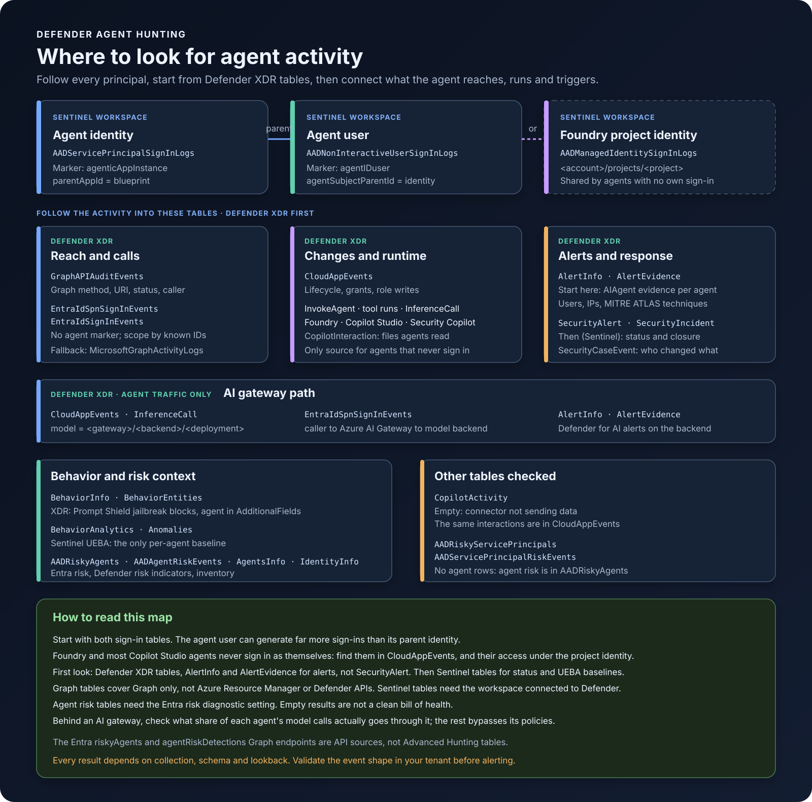

An agent identity can look quiet while the agent user it represents is busy. That distinction changes how I hunt Microsoft Entra agents: I want to know which agents are active, what they reach, what they change, and whether their activity fits the job they were built to do.

I put the full set of tested queries in [my GitHub repository](https://github.com/pisinger/scripts-lib/blob/main/agentic/defender-agent-activity-hunting.md). It covers sign-ins, Microsoft Graph calls, lifecycle and permission events, alerts, risk, behavioral baselines, the agent runtime (Foundry agents, models, tools, and content safety), agent traffic through an AI gateway, and Copilot interactions. This post focuses on the hunting model and the signals I would start with rather than reproducing all 65 queries.

> **In short:** Follow every principal an agent can act as: the agent identity, the agent user, and for Foundry agents the shared project identity. Start from the Defender XDR tables, add the Sentinel tables for status and baselines, and treat new behavior on an established agent as a lead, not a verdict.
{: .prompt-tip}

## Where to look first

There is no single agent activity table. This map covers the tables I queried in my tenant; the source column distinguishes Sentinel workspace tables from Defender XDR tables. Most tenants that hunt this way have a Sentinel workspace connected, so both sets of tables are usually there.

> **XDR first, Sentinel second:** Where both hold the same or similar data, my first look is the Defender XDR table. For alerts that means `AlertInfo` and `AlertEvidence`, not `SecurityAlert`, even though `SecurityAlert` would also work: the XDR tables carry the evidence entities and agent fields in the shape Defender's own detections use. The Sentinel tables then add what XDR lacks, mainly alert and incident status and UEBA baselines.
{: .prompt-info}

> **Reading "no agent rows":** The table was present or queried but returned no agent-related rows in that test. It does not mean the table is empty everywhere or that the activity cannot be recorded elsewhere.
{: .prompt-info}



| Table | Source | What it can show | Test and access notes |
|---|---|---|---|
| `AADServicePrincipalSignInLogs` | Sentinel workspace | Agent identity token requests, blueprint marker, requested resources, IPs, and failures | Agent identity marker is in `Agent`; workspace data requires Sentinel connected to Defender. |
| `AADNonInteractiveUserSignInLogs` | Sentinel workspace | Agent user sign-ins, parent agent ID, resources, IPs, and failures | Agent user marker is in `Agent`; this was often much higher volume than identity sign-ins. |
| `GraphAPIAuditEvents` | Defender XDR | Graph method, URI, status, scopes, and caller (`ApplicationId` or `AccountObjectId`) | First choice for Graph. High volume; keep a time filter. `ResponseStatusCode` is a string. |
| `MicrosoftGraphActivityLogs` | Sentinel workspace | The same Graph calls (`AppId` or `UserId`) | Fallback only; coverage matched `GraphAPIAuditEvents`. |
| `AADManagedIdentitySignInLogs` | Sentinel workspace | Foundry project managed identities (`<account>/projects/<project>`) | Carries the outbound calls of Foundry agents that do not use their own agent identity. |
| `EntraIdSpnSignInEvents`, `EntraIdSignInEvents` | Defender XDR | XDR schema for agent identity and user sign-ins, and the AI gateway path (tokens for `Azure AI Gateway`, gateway identity to model backend) | No agent marker; use known IDs to scope these tables. |
| `CloudAppEvents` | Defender XDR | Agent lifecycle and access events, permission grants, role assignment writes, and runtime events: `InvokeAgent` (caller, target agent, content filter verdict), `ExecuteToolBySDK`, `InferenceCall` (model, including the AI gateway route), `AISpanOutput`, `CopilotInteraction` (files and sites agents read, with sensitivity label) | The only place Foundry and most Copilot Studio agents show up by agent ID. Operations depend on the emitting product. |
| `AlertInfo`, `AlertEvidence` | Defender XDR | Agent-related alerts, the users and IPs around them, MITRE ATLAS techniques, and Defender for AI alerts on the models behind agents | First choice for alerts. `AIAgent` evidence carries `AgentId`, `AgentName` and the hosting platform. No status. |
| `SecurityCaseEvent` | Sentinel workspace | Change log of incident cases: status, classification, assignment, tags and comments, with before and after values and who changed them | Second step for incident history; better than `SecurityIncident` snapshots for who decided what. [Reference](https://learn.microsoft.com/azure/azure-monitor/reference/tables/securitycaseevent). |
| `SecurityAlert`, `SecurityIncident` | Sentinel workspace | Alert status, classification, closure, and incident history | Second step, for status and closure. Incident rows are versioned; select the latest version. |
| `BehaviorAnalytics`, `Anomalies` | Sentinel workspace | UEBA logons and anomaly signals involving agent identities | The only per-agent baseline (first-time country, ISP, action). Agent logons appear as service principal activity. |
| `BehaviorInfo`, `BehaviorEntities` | Defender XDR | Aggregated Defender behaviors, including Prompt Shield jailbreak blocks on AI agents | The agent is named in `BehaviorInfo.AdditionalFields`, not as an entity. |
| `AADRiskyAgents`, `AADAgentRiskEvents` | Sentinel workspace | Entra agent risk state and individual detections | Requires the Entra risk diagnostic setting. |
| `AgentsInfo` | Defender XDR | Agent inventory and active `RiskIndicators`; joins to Entra through `EntraAgentID` | Defender AI agent inventory table used as a name and risk context source. |
| `IdentityInfo` | Defender XDR | Account risk and criticality fields for agent users | Risk level and score were empty for the agent users I checked. |

Two results are worth knowing in advance. `AADRiskyServicePrincipals` and `AADServicePrincipalRiskEvents` returned no agent rows: agent risk lives in `AADRiskyAgents` and `AADAgentRiskEvents` instead. `CopilotActivity` was present but completely empty, as its connector was not sending data; the same Copilot interactions were already in `CloudAppEvents` as `CopilotInteraction`, another case where the Defender XDR table is the better first look. For live Entra agent risk data, the query set also refers to Microsoft Graph `riskyAgents` and `agentRiskDetections` endpoints; those are API calls, not hunting tables, and the available test token lacked the required permission.

## 🧭 Follow both parts of the agent

Entra agent activity can appear under two principals: the agent identity and its associated agent user. The identity may request tokens for platform resources, while the agent user carries much of the downstream activity. One agent identity had 22 sign-ins while its agent user had roughly 149,000.

> **Count both principals:** A hunt that only counted identity sign-ins would have missed nearly all of that volume. Always summarize the agent identity and its agent user together.
{: .prompt-warning}

The Sentinel workspace tables make the distinction visible through the `Agent` field. For an agent identity, the marker is `agentType == "agenticAppInstance"`, and `parentAppId` identifies its blueprint. For an agent user, the marker is `agentSubjectType == "agentIDuser"`, and `agentSubjectParentId` points back to the parent agent identity. Start by checking whether these markers appear in your connected data, then summarize both principals together.

The Defender XDR sign-in tables do not carry the same agent markers. The query set includes an XDR fallback that uses known agent identity object IDs, but the joined `ServicePrincipalId` format alone is not enough to identify an agent: managed identities use it too. Where available, the marked workspace sign-in records provide a stronger starting point.

## 🔎 Build a picture before writing a detection

I would begin with three questions:

- **Which agents are active?** Inventory identity and agent user sign-ins, volumes, resources, IP counts, and failures.
- **What do they reach or change?** Review resource token requests, Microsoft Graph calls, write operations, permission grants, and Azure role assignment activity.
- **Does the activity fit the agent's role?** Compare with prior behavior, sibling agents created from the same blueprint, and the agent's expected tools and permissions.

The first useful signal is often a change in context, not a single suspicious call. A newly requested resource, a new Graph API family, an unfamiliar IP, or a sharp change in daily volume can tell you where to investigate. One established agent started using five additional resources within about two minutes. The surrounding activity pointed to a real triage job, including mail access and Security Copilot tool runs, and the resource count returned to its previous level the next day.

> **Unusual is not malicious:** That was activity worth explaining, but not by itself proof of compromise. Check the agent's job, its recent tasks and its tool runs before escalating.
{: .prompt-info}

## Start with sign-in inventory

This first query finds agent identities marked in the Sentinel sign-in table. It summarizes activity by identity and blueprint, including the resources requested and number of source IPs:

```kql
AADServicePrincipalSignInLogs
| where TimeGenerated > ago(30d)
| extend A = todynamic(Agent)
| where A.agentType == "agenticAppInstance"
| summarize SignIns = count(), Resources = dcount(ResourceDisplayName),
    ResourceNames = make_set(ResourceDisplayName, 10),
    IPs = dcount(IPAddress), Failures = countif(ResultType != "0"), LastSeen = max(TimeGenerated)
    by ServicePrincipalName, AgentId = ServicePrincipalId, BlueprintAppId = tostring(A.parentAppId)
| order by SignIns desc
```

Generalized output:

```text
ServicePrincipalName   AgentId       BlueprintAppId  SignIns  Resources  ResourceNames                                     IPs  Failures
Example Recon Agent    <agent-id-a>  <blueprint-id>  23       7          ["Microsoft Graph","Azure Resource Manager",...] 1    0
Example Triage Agent   <agent-id-b>  <blueprint-id>  22       1          ["AAD Token Exchange Endpoint: Public"]       4    0
Example HR Helper      <agent-id-c>  <blueprint-id>  2        1          ["Bot Framework"]                              1    2
```

Look for identities you do not recognize, unexpected resources, and an unusually broad set of IPs for one agent. The identity count alone is not a measure of total agent activity, though. The companion query below looks for agent users and links each one back to its parent identity:

```kql
let identityNames = AADServicePrincipalSignInLogs
    | where TimeGenerated > ago(30d)
    | extend A = todynamic(Agent)
    | where A.agentType == "agenticAppInstance"
    | summarize AgentName = take_any(ServicePrincipalName) by ParentAgentId = ServicePrincipalId;
AADNonInteractiveUserSignInLogs
| where TimeGenerated > ago(14d)
| extend A = todynamic(Agent)
| where A.agentSubjectType == "agentIDuser"
| summarize SignIns = count(), Resources = dcount(ResourceDisplayName),
    ResourceNames = make_set(ResourceDisplayName, 10), IPs = dcount(IPAddress),
    Failures = countif(ResultType != "0"), LastSeen = max(TimeGenerated)
    by UserPrincipalName, AgentUserId = UserId, ParentAgentId = tostring(A.agentSubjectParentId)
| join kind=leftouter identityNames on ParentAgentId
| project AgentName = coalesce(AgentName, "(name not found)"), ParentAgentId,
    UserPrincipalName, AgentUserId, SignIns, Resources, ResourceNames, IPs, Failures, LastSeen
| order by SignIns desc
```

The user sign-in result shows why both views matter:

```text
AgentName            ParentAgentId  UserPrincipalName              AgentUserId   SignIns  Resources  ResourceNames                                  IPs  Failures
Example Triage Agent <agent-id-a>   agentuser-a@example.invalid     <user-id-a>    61581    11         ["Microsoft Graph","Azure Purview",...]       5    35
Example Recon Agent  <agent-id-b>   agentuser-b@example.invalid     <user-id-b>    14632    11         ["Azure Purview","WindowsDefenderATP",...]    1    0
Example Main Agent   <agent-id-c>   agentuser-c@example.invalid     <user-id-c>    7098     2          ["Azure Purview","Security Copilot API"]      1    0
```

In one test example, an agent identity had 22 sign-ins while its user had about 149,000. The user query above uses a 14-day window while the identity inventory uses 30 days; adjust those periods to suit your review. If an identity did not sign in during the lookback, the parent ID still appears and can be resolved against the Defender inventory or Microsoft Graph.

For Graph activity, group calls into API families and inspect methods, URI paths, status, and caller. Include both the agent identity (`ApplicationId`) and the agent user (`AccountObjectId`). The query set also handles a double slash in some clients' Graph paths; a single-slash-only parser would have left 238 of one agent's 1,745 calls uncategorized. Treat a new API family as a lead, then compare it with the agent's stated purpose and granted access.

Here is a focused query for Graph calls made by agent identities. It discovers known agent app IDs from the marked sign-in records, then reads the Defender XDR table `GraphAPIAuditEvents`, groups calls by HTTP method and API family, and counts failed responses. Note that `ResponseStatusCode` is a string there:

```kql
let agentApps = AADServicePrincipalSignInLogs
    | where TimeGenerated > ago(30d)
    | extend A = todynamic(Agent)
    | where A.agentType == "agenticAppInstance"
    | distinct AppId;
GraphAPIAuditEvents
| where Timestamp > ago(30d)
| where ApplicationId in (agentApps)
| extend Family = extract(@"/(?:v1\.0|beta)/+([^/?]+)", 1, RequestUri)
| summarize Calls = count(), Failed = countif(toint(ResponseStatusCode) >= 400),
    LastCall = max(Timestamp) by AppId = ApplicationId, RequestMethod, Family
| order by Calls desc
```

Generalized sample results:

```text
AppId         RequestMethod  Family             Calls  Failed
<agent-app-id> GET            servicePrincipals   1263   7
<agent-app-id> POST           directoryObjects    134    1
<agent-app-id> GET            roleManagement      24     2
```

In this example, the calls are mostly reads of service principals, with some directory object writes and role management reads. Whether that is expected depends on the agent's purpose and permissions. The `+` in the path-family expression tolerates clients that send a doubled slash, such as `v1.0//servicePrincipals`; without it, those calls can be left uncategorized. Repeat the analysis for agent users by discovering their `UserId` values from `AADNonInteractiveUserSignInLogs` and filtering `GraphAPIAuditEvents` on `AccountObjectId`. If you only have the Sentinel table, `MicrosoftGraphActivityLogs` works the same way with `AppId`, `UserId` and `TimeGenerated`, and a numeric status code.

## 🤖 Agents that never sign in

The sign-in inventory above has a blind spot. Every Foundry agent and most Copilot Studio agents ran tools and model calls under an Entra agent ID that never requested a token of its own. They appear only in the Agent 365 runtime events in `CloudAppEvents`, and their outbound calls go through the Foundry project managed identity instead. That is the `project-managed-identity` option I described in [the Agent ID access audit post](https://pisinger.github.io/posts/microsoft-entra-agent-id-auditing-agent-access-across-identities/): one identity shared by every agent in the project.

This query lists the agents seen at runtime and checks whether their own identity ever signed in:

```kql
let signedIn = union
    (AADServicePrincipalSignInLogs
        | where TimeGenerated > ago(30d)
        | extend A = todynamic(Agent)
        | where A.agentType == "agenticAppInstance"
        | distinct Id = ServicePrincipalId),
    (AADNonInteractiveUserSignInLogs
        | where TimeGenerated > ago(30d)
        | extend A = todynamic(Agent)
        | where A.agentSubjectType == "agentIDuser"
        | distinct Id = tostring(A.agentSubjectParentId));
CloudAppEvents
| where Timestamp > ago(30d)
| where ActionType in ("InvokeAgent", "ExecuteToolBySDK", "ExecuteToolByGateway", "InferenceCall", "AISpanOutput")
| extend R = parse_json(RawEventData)
| extend AgentId = coalesce(tostring(R.TargetAgentId), tostring(R.AgentId)),
    AgentName = coalesce(tostring(R.TargetAgentName), tostring(R.AgentName)),
    Platform = coalesce(tostring(R.PlatformTargetAgentType), tostring(R.AgentPlatform), tostring(R.PlatformAgentType))
| where isnotempty(AgentId) and AgentId != "00000000-0000-0000-0000-000000000000"
| summarize Events = count(), Names = make_set(AgentName, 3), First = min(Timestamp), Last = max(Timestamp)
    by AgentId, Platform
| join kind=leftouter (signedIn | distinct Id | extend SignsIn = true) on $left.AgentId == $right.Id
| extend IdentityUse = iff(SignsIn == true, "agent identity signs in", "no agent sign-in seen")
| project Platform, Names, AgentId, IdentityUse, Events, First, Last
| order by Platform asc, Events desc
```

```text
Platform         Names                      IdentityUse              Events  First       Last
AzureAIFoundry   ["example-phish-triage"]   no agent sign-in seen    555     2026-11-17  2026-11-20
AzureAIFoundry   ["example-agent-dev"]      no agent sign-in seen    78      2026-11-19  2026-11-19
CopilotStudio    ["Example HR Helper"]      agent identity signs in  299     2026-10-25  2026-11-20
CopilotStudio    ["Example HR Autonomous"]  no agent sign-in seen    387     2026-10-26  2026-11-03
SecurityCopilot  ["...InvestigationAgent"]  agent identity signs in  266     2026-11-19  2026-11-20
```

For the rows marked `no agent sign-in seen`, the access to review sits on the project identity. Find it in `AADManagedIdentitySignInLogs`, where its name has the form `<account>/projects/<project>`.

> **Shared identity, shared blast radius:** Every permission the project identity holds is available to every agent in that project, and the logs cannot tell you which agent used it. Prefer per-agent identities where the platform supports them, and review the project identity together with the agents.
{: .prompt-warning}

The same runtime events carry more than identity. `InvokeAgent` records who called which agent and includes the content filter verdict for Foundry agents. `InferenceCall` names the model behind each turn. `ExecuteToolBySDK` lists the tools and MCP servers an agent used. That was enough to see:

- 26 prompts blocked as jailbreaks against two Foundry agents, all from one user testing prompt injection. Defender records the same 26 blocks in `BehaviorInfo` as `BehaviorPromptShieldJailbreakBlock`, and an "AI agent reconnaissance activity" alert fired within a minute of one burst.
- Microsoft's newer Defender agents in Security Copilot running `bash` and `apply_patch` in their sandbox.
- Agent loops run through the SDK from a home broadband address rather than from Azure.
- An agent that an admin had confirmed as compromised in Entra ID Protection, still enabled and still invoked the next day.

> **Confirmed compromised does not mean stopped:** Confirming compromise raises the agent's risk level. The agent keeps working until a risk-based Conditional Access policy for agents blocks it or someone disables it.
{: .prompt-danger}

`CopilotInteraction` events show what that meant in practice. They record each Copilot turn and, for Microsoft 365 and Copilot Studio agents, every file, site, connector and web page the agent read, with the file's sensitivity label. The same HR agent read two labelled salary lists on the day after it was confirmed compromised. The events also show who drives Security Copilot: agent users sent 73 percent of all Security Copilot interactions.

If the agents sit behind an AI gateway, the same `InferenceCall` events show whether they actually use it: a gateway-routed call names the model as `<gateway>/<backend account>/<deployment>`. My main Foundry agent sent only 46 percent of its model calls through the gateway and the rest straight to the backend.

> **Check the gateway share:** A gateway only protects the traffic that goes through it. Here its token limits and content safety covered about half of the agent's model calls; the rest reached the same model directly.
{: .prompt-warning}

 `EntraIdSpnSignInEvents` shows the identities on that path, and Defender for AI Services alerts on the backend model (here, eight High-severity ASCII smuggling alerts) can be tied back to the agents that use it. The query set covers this in its own section; gateway configuration is a control-plane topic for another post.

For an investigation-oriented view of the same runtime data, including prompt and reply content from the Agent 365 observability data lake table, have a look at the [ai-agent-activity skill](https://github.com/SCStelz/security-investigator/blob/main/.github/skills/ai-agent-activity/SKILL.md) in SCStelz's security-investigator repository. It complements the hunting angle here well.

## 🚨 Start alert hunting from AlertEvidence

Alerts on agents carry an `AIAgent` evidence entity whose `AdditionalFields` holds the agent ID, its name and the hosting platform. That makes `AlertInfo` and `AlertEvidence` the right first look for a per-agent view, with no list of agent IDs needed. `SecurityAlert` holds the same alerts, but I would not start there:

```kql
let agentAlerts = AlertEvidence
    | where Timestamp > ago(30d)
    | where EntityType == "AIAgent"
    | extend AF = parse_json(AdditionalFields)
    | project AlertId, AgentId = tostring(AF.AgentId), AgentName = tostring(AF.AgentName), Platform = tostring(AF.HostingPlatformType);
agentAlerts
| join kind=inner (AlertInfo | where Timestamp > ago(30d) | summarize arg_min(Timestamp, Title, Severity, Category) by AlertId) on AlertId
| summarize Alerts = dcount(AlertId), Titles = make_set(Title, 5), Severities = make_set(Severity), Categories = make_set(Category),
    ActiveDays = dcount(bin(Timestamp, 1d)), First = min(Timestamp), Last = max(Timestamp)
    by AgentName, AgentId, Platform
| order by Alerts desc
```

```text
AgentName              Platform                Alerts  Titles                                              ActiveDays  Last
Example HR Helper      MicrosoftCopilotStudio  22      ["A cross or external prompt Injection attack..."]  7           2026-11-20
example-phish-triage   MicrosoftFoundry        3       ["AI agent reconnaissance activity was detected"]   1           2026-11-18
```

From there, the other evidence in the same alerts shows who was talking to the agent and from where, and `AlertInfo.AttackTechniques` carries MITRE ATLAS IDs such as `AML.T0051` for prompt injection. `AlertInfo` and `AlertEvidence` have no status, so whether an alert was resolved, and by whom, still comes from `SecurityAlert` and `SecurityIncident`. I use them as the second step, after the XDR view, not as the starting point.

> **Who decided what:** For who changed a case and how, the newer `SecurityCaseEvent` table is better than `SecurityIncident`. It logs every property change with the previous and new value and the author, while `SecurityIncident` only keeps the last modifier.
{: .prompt-tip}

Here, `SecurityCaseEvent` showed that the Security Copilot agent user only tagged the cases it worked on, while the status and classification were set by a SOAR application and by Defender's automation.

## 🧰 Use the telemetry that answers the question

There is no single table for the whole investigation. Sign-in logs help establish the principals and requested resources. `GraphAPIAuditEvents` shows Graph calls. `CloudAppEvents` contains relevant agent lifecycle and access events, permission grants, Azure role assignment writes, and the runtime events of Foundry, Copilot Studio and Security Copilot agents. `AlertInfo` and `AlertEvidence` provide detection context; the Sentinel alert and incident tables add status and closure when the workspace is connected. UEBA, Entra ID Protection, and Defender's `AgentsInfo` inventory can add behavior or risk context when those sources are configured and populated.

Availability matters. The workspace sign-in tables, `MicrosoftGraphActivityLogs` and `SecurityCaseEvent` require the Sentinel workspace to be connected to Defender, while `GraphAPIAuditEvents`, `AlertInfo` and `AlertEvidence` come with Defender XDR itself; the agent risk tables require the Entra risk diagnostic setting. Some Defender tables have no agent rows for me, and Defender behaviors name agents in `AdditionalFields` rather than as a dedicated entity type; an early version of my behavior query matched on entities only and wrongly reported nothing.

> **Empty is not safe:** An empty result can mean no activity, missing data, an unsupported table, or a filter that did not match. Check ingestion and validate the event shape before treating it as assurance. The same goes for missing risk scores: "no value available here" is not "safe".
{: .prompt-warning}

The full query set also includes failure interpretation and alert closure context. For example, a repeated consent failure and a Conditional Access block call for different responses. Likewise, an agent user shown as the last incident modifier is not necessarily the one that made the closure decision: check the incident comments, classification, and alert-level resolution before attributing it.

## 📈 Baselines need context

Several queries compare an established agent's recent activity with its own earlier behavior. The same principle applies to IPs, operating hours, sign-in volume, failure rates, Graph families, tools, and client library versions. New agents have no meaningful history, so the baseline hunts skip them; otherwise, all first-seen behavior would appear anomalous.

Baseline results are investigation prompts, not verdicts. A useful threshold depends on the agent's normal workload. One of my agents had a high failure rate throughout the month, which suggested a persistent operational issue rather than a sudden behavioral change. Another temporarily expanded its resource use during a real triage task. Alert on deviations that matter to your environment, and keep expected jobs and maintenance windows in the baseline.

Risk data needs the same restraint. Entra agent risk events and Defender `AgentsInfo` risk indicators can add important context, but they are separate views and may not be populated for every agent. `IdentityInfo` risk fields were empty for my agent users. As with empty query results, read a missing score as missing, not as safe.

## ⚠️ Validate before operationalizing

These queries were run against my own tenant with recently created agents; names and IDs in examples are generalized. Some candidate tables had no agent rows, some risk mappings were not exercised, and the live Microsoft Graph risk calls could not be run with the available token permissions. Your data sources, agent types, and workload will differ.

Advanced Hunting also has a limited query window, and the hunting API is throttled. The repository notes the relevant table requirements and query assumptions. 

> **Before you alert:** Confirm that the table is connected, the agent marker matches your tenant's events, and the output is stable enough to support a meaningful threshold.
{: .prompt-warning}

Use an appropriate longer-term collection path when you need retention beyond the hunting window.

## 📝 Conclusion

Agent hunting works best when it follows the identity, the agent user, and, for Foundry agents, the shared project identity, then joins their activity to the resources, tools, models, permissions, and tasks they are expected to use. Start from the Defender XDR tables and add the Sentinel ones for status and baselines. Start with an inventory, learn the event shapes in your tenant, and baseline established agents before treating novelty as risk. 

> The [complete query set](https://github.com/pisinger/scripts-lib/blob/main/agentic/defender-agent-activity-hunting.md) is the working reference, including the deeper hunts and caveats behind this overview.
{: .prompt-tip}
